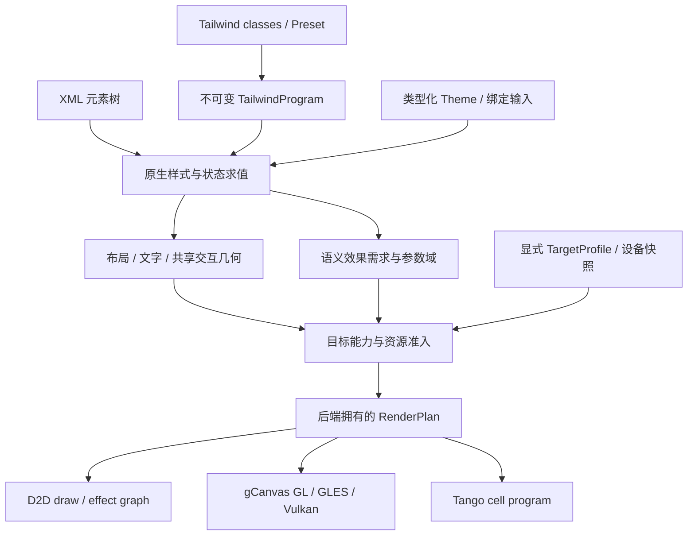

# 原生 Tailwind 与多后端效果 / Shader 契约

- 决策日期：2026-10-29。
- 状态：设计已确定，运行时迁移待实现；本文的概念接口不是现有公开 ABI。
- 源码基线：[`5ef5d4428bbad4256986240b17a3662c379e3222`](https://github.com/qigao/stun/tree/5ef5d4428bbad4256986240b17a3662c379e3222)。
- 唯一实施 tracker：[#17](https://github.com/qigao/stun/issues/17)；XML schema 见 #16，平台交付见 #31，真实 GUI 验收见 #330。
- 本文取代 `XML_CSS_TBS_ARCHITECTURE.md`、`TAILWIND_JIT_DEFAULT_DESIGN.md` 及相关计划中的 CSS-first、生成 CSS、可选应用 CSS 和 `@theme` 输入决策。原有 UI 所有权、controller、服务与组件退休契约继续有效。

## 1. 决策与范围

应用的唯一作者模型是 **XML + Tailwind + TurboScript**：XML 描述结构，标准 `class` 承载 Tailwind，TurboScript 通过有界命令修改状态。主题和控件默认样式分别使用原生类型化 Theme 与 Tailwind Preset。

Tailwind 原生编译器直接生成不可变 `TailwindProgram`，供统一的属性、条件、布局、文字和绘制管线消费。目标运行时删除手写 CSS、`.css` 资源、`style="..."` 声明、CSS 加载 API、CSS 解析前端、生成 CSS 的中间格式及其 fallback。也不把 CSS 内容搬进 JSON 字符串。

一个语义效果可以有不同后端实现。**EffectId 表达效果；shader、D2D effect graph 和终端 cell 操作表达实现。** 后端不重新解释 Tailwind，不拥有另一棵 UI 树。

Tango 没有可编程 GPU shader。D2D 与 gCanvas 的 shader 格式、能力与资源生命周期也不同。任何能力未实现、参数超限或设备失效都必须产生明确结果，不能静默丢掉效果、切换 renderer、降低效果质量或重试另一个 provider。

本设计不引入样式字节码 VM，不修改 chart DSL / Mermaid grammar，不以新 workflow 或 ruleset 代替已有后端验收。

## 2. 当前事实与目标必须分开

以下是基线源码事实，不代表新的接口已经完成：

| 范围 | 基线事实 | 迁移目标 |
| --- | --- | --- |
| Tailwind | `UtilityCatalog` 精确 token 查找，生成 CSS 后进入 StyleEngine | 原生 utility / variant / value 编译，直接生成类型化程序 |
| 属性 | 已有 `StylePropertyDesc`、CMeta 类型与 layout/text/paint/hit-test/composite impact；typed value 覆盖仍有限 | 扩展同一个 registry 和求值器，覆盖布局、主题、动画和效果所需类型 |
| 能力 | `RendererCapabilities` 主要是 shadow、blur、rotation 等布尔值 | 可查询的效果、参数域、格式、资源与设备契约 |
| D2D | 借用 `ID2D1RenderTarget*`；基础图形/文字/图片；shadow/blur 为 false，非空请求抛错 | 基础绘制 profile 加经过单独实现与验收的 D2D effect profile |
| Tango | 当前为 8×16 逻辑像素到 cell 的适配；若干不支持的操作是 no-op，圆角和部分 alpha 行为不完整 | 显式 TerminalCell profile，严格准入与完整终端语义 |
| gCanvas | 已有 GL/GLES/Vulkan 实现和参数化 shader；部分效果有输入/变换限制；当前 renderer 不支持 retained mode | 分别声明每个 API profile 和效果域，建立有界程序/资源缓存 |

源码证据：[utility 编译器](https://github.com/qigao/stun/blob/5ef5d4428bbad4256986240b17a3662c379e3222/flexUI/modules/tailwindcss/compiler.cpp)、[属性 registry](https://github.com/qigao/stun/blob/5ef5d4428bbad4256986240b17a3662c379e3222/flexUI/include/flexUI/detail/style_property_registry.h)、[RendererCapabilities](https://github.com/qigao/stun/blob/5ef5d4428bbad4256986240b17a3662c379e3222/flex/include/flex/core/renderer.h)、[D2D](https://github.com/qigao/stun/blob/5ef5d4428bbad4256986240b17a3662c379e3222/flex/backends/d2d/renderer.cpp)、[Tango adapter](https://github.com/qigao/stun/blob/5ef5d4428bbad4256986240b17a3662c379e3222/flex/backends/tui/renderer.cpp)、[gCanvas adapter](https://github.com/qigao/stun/blob/5ef5d4428bbad4256986240b17a3662c379e3222/flex/render/engines/gcanvas/renderer.cpp)。

现有 no-op、采样近似和粗粒度能力标志是迁移审计对象，不能直接成为新能力声明的证据。[CSS_SUPPORT_MATRIX.md](CSS_SUPPORT_MATRIX.md) 保留为功能迁移清单，防止删除 CSS 时丢失已经存在的行为。

## 3. 编译与执行分层



这是逻辑分层，不要求每帧重建所有对象。静态规则、类型与常量可提前编译；状态、主题、文本、viewport 和 container 变化按依赖更新。容器条件可以要求布局后的有界重算，沿用单一布局事实源。

| 对象 | 内容与所有权 | 不得包含 |
| --- | --- | --- |
| `TailwindProgram` | 共享不可变；候选、条件、类型化声明、来源与依赖 | CSS 文本、Element 指针、设备对象、可变脚本状态 |
| `UiInputSnapshot` | 准备事务拥有；候选 class、Theme、Binding 输入和 viewport 的不可变快照 | 提前写入 live Box 的候选 mutation |
| `EvaluatedStyleSnapshot` | Box/目标实例拥有；特定 UI/theme/viewport revision 下的结果 | 后端 shader ID |
| `EffectRequirements` | 效果语义、参数域、输入、输出范围与预算 | 未经验证的“所有后端支持”结论 |
| `RenderCommandList` | 布局后的几何和语义绘制/合成请求 | Tailwind 字符串、CSS 选择器、脚本求值 |
| `BackendRenderPlan` | 单一 backend owner 拥有；已准入计划和资源租约 | 任意跨后端 handle、失败后的隐式降级路径 |

普通属性、动画、Binding 和 effect 参数共用 `StylePropertyDesc` / CMeta 语义类型。单位、有限性、范围和 native storage 必须同时验证；类型描述符地址不是持久身份。不得再造第二套 Tailwind property evaluator。

## 4. 作者输入与兼容范围

### 4.1 Tailwind 与主题

- `class` 是唯一 utility 作者入口；退役 `utility` / `utilities` 平行入口和手写 CSS class 规则。
- `group` / `peer` 等合法 marker 由 Tailwind grammar 识别；业务身份使用 ID、part、role 或 data 属性。未知 class 不静默保留给不存在的应用 CSS。
- 固定上游版本及 NativePixel 兼容 profile，记录覆盖顺序、important、theme、base defaults、单位、variant 组合和 arbitrary syntax 的语义。不可用 markup class 顺序替代 utility 优先级。
- 类型化 Theme 保存颜色、长度、字体、断点、阴影和动画定义；Preset 只组合 utility 和控件 part 的默认 class。需要文件时使用这些数据的版本化序列化，不接受 CSS `@theme` / `@apply` / `@utility` 输入。
- 支持范围内的 arbitrary value、变量、`calc()`、关系条件直接编译成类型化表达式/条件节点，不调用 CSS parser。未实现语法或语义返回明确诊断。
- 自定义视觉效果引用注册的、版本化 EffectId 和参数 schema。其 utility 扩展必须在 profile 显式声明；XML/TurboScript 不提供任意 HLSL、GLSL 或设备指针。本文不新增尚未定义的 `d2d:` / `tango:` 伪标准 variants。

570 个精确 token 的当前 catalog 只能作为迁移覆盖数据，不能冒充完整 native compiler。测试工具可以使用固定上游工具链产生离线参考数据；安装运行时和产品输入均不依赖 CSS、Node/npm 或浏览器。

### 4.2 Pixel 与 Terminal 是不同目标契约

应用显式选择目标配置，而不是在绘制失败后选择备用目标：

| 目标 | 坐标与主题 | 后端 |
| --- | --- | --- |
| `NativePixel` | 明确 logical/device 单位、DPI、字体度量、颜色与 alpha 契约 | D2D 或某个 gCanvas API profile |
| `TerminalCell` | 明确 row/column、grapheme 宽度、整数间距 token、可用颜色/文本属性和边框字符 | Tango |

同一个应用可共享 XML 结构、业务状态和 controller，并显式提供不同目标的 Theme/Preset。终端 profile 不声称与桌面有相同像素几何或完整 Tailwind v4 CSS 输出等价性。

例：桌面 preset 可以要求 `shadow-md`；终端 preset 可以明确选择已支持的背景、边框或文本强调。后者是作者声明的终端设计，不能作为 shadow 失败后的自动替代。没有已声明单位映射时，`w-[13px]` 不得偷偷四舍五入为列；无法实现的圆角、透明合成、blur、任意旋转必须拒绝。16/256/truecolor、Unicode 宽度和终端图像协议也需要各自能力声明，不能因终端能输出字符就默认支持。

## 5. 后端实现与 shader 产物

| 后端 profile | 实现与产物契约 | 重要限制 |
| --- | --- | --- |
| D2D primitives | D2D 原生几何、文字、图像和 clip 操作；无需应用 shader | 当前 adapter 的已支持范围须独立记录 |
| D2D effects | `ID2D1DeviceContext` 内置 effect graph，或注册的 custom effect / transform + D2D 兼容 HLSL 编译字节码 | 待实现；必须验证 context、feature level、shader model 和 effect 属性布局；不假设任意 DXIL 可载入 |
| gCanvas desktop GL | desktop GLSL program，当前模板为 `#version 410 core`；GL 参数/实例布局 | 记录 GL 版本、扩展、uniform/texture 限制及编译链接结果 |
| gCanvas GLES | 独立 ESSL profile，当前生成器使用 `#version 300 es` 和精度声明 | precision、UBO 容量与纹理限制独立检查；不是 desktop GL 产物直接复用 |
| gCanvas Vulkan | SPIR-V modules + descriptor/pipeline layout | 记录 SPIR-V/Vulkan 目标、格式、资源布局、特化值与设备特性 |
| Tango | 原生 cell、文本属性、边框、滚动与输出批次 | 无 GPU shader；无对应 terminal 语义的效果返回 Unsupported |

现有 gCanvas shader 证据：[GL/GLES 源转换](https://github.com/qigao/stun/blob/5ef5d4428bbad4256986240b17a3662c379e3222/shared/gcanvas/src/backends/opengles/gles_shader_source.cpp)、[GL 编译与实例绘制](https://github.com/qigao/stun/blob/5ef5d4428bbad4256986240b17a3662c379e3222/shared/gcanvas/src/backends/gl/context_impl_gl.cpp)、[Vulkan module 与提交](https://github.com/qigao/stun/blob/5ef5d4428bbad4256986240b17a3662c379e3222/shared/gcanvas/src/backends/vulkan/context_impl_vulkan.cpp)、[圆角/阴影 shader](https://github.com/qigao/stun/blob/5ef5d4428bbad4256986240b17a3662c379e3222/shared/gcanvas/src/shaders/rounded_rect.frag)。

基线 GL 和 Vulkan 的这条绘制管线只注册 vertex/fragment 阶段，不能据此声明 compute 已接入。GLSL 410 / ESSL 300 es 也不提供 core compute 保证；Khronos 分别在 [OpenGL 4.3](https://www.khronos.org/news/press/khronos-releases-opengl-4.3-specification-with-major-enhancements) 和 [OpenGL ES 3.1](https://www.khronos.org/news/press/khronos-releases-opengl-es-3.1-specification) 引入 core compute 能力。

Microsoft 的 [custom effects](https://learn.microsoft.com/en-us/windows/win32/direct2d/custom-effects) 文档定义了 HLSL effect/transform 的加载和设备检查方式。这证明该目标可实现，不证明 Stun 当前已接入。D2D native effect 注册所需元数据属于后端 API，不是应用 CSS。

### 5.1 语义效果注册

一个 `EffectId + SemanticVersion` 至少定义：

- 输入种类：元素内容、子树合成图、明确捕获的 backdrop、纹理或几何；backdrop blur 与普通 blur 是不同请求。
- 参数类型、单位、有限范围、动态范围与结构/特化/pipeline-key 参数。
- 输入/输出格式、颜色空间、premultiplied alpha、采样和混合规则。
- 输出 bounds、滤波采样范围、clip、离屏扩张和嵌套合成规则。
- 对 layout、text、paint、hit-test、composite 的影响，以及可验收的数值/图像误差界。

组 opacity 必须保持对子树整体合成的语义，不能直接替换成每个图元各乘 alpha。语义 transform 同时更新绘制与命中几何。纯装饰效果可以扩大 paint bounds，但不得暗中扩大点击区域；改变交互几何的自定义效果必须声明一致的几何映射。

跨后端可以采用不同的、预先注册并通过同一语义契约的算法。声明的数值容差是效果定义的一部分，不能在资源紧张时临时降低质量。现有采样近似未经对应验收前不能登记为支持。

### 5.2 原生产物包

每个 `BackendProgramVariant` 必须具有明确 manifest：

- EffectId/语义版本、backend family/API、target profile 及实现版本。
- artifact 类型、源码/编译产物 hash、生成工具版本、目标 shader profile；D2D/HLSL、GLSL、ESSL、SPIR-V 不可互换。
- 每个 shader module 的 stage、entry point 和目标 profile；native builtin 登记原生 effect 绑定。
- 参数 ABI、布局/对齐、sampler/texture/descriptor 要求、输入输出格式和资源访问方式。
- 支持的参数/变换域、pass 图和中间 surface 预算，以及依赖资源的版本。

多 pass 实现必须声明 graphics/compute/native-effect pass 图、各 pass 的资源读写及区域、先后依赖、初始化与别名约束。后端据此生成自身的可见性、同步和状态转换操作，并按活跃区间计算中间资源预算。未声明的反馈、读写冲突或循环依赖不得通过准入；D2D native effect graph 按其原生图契约验证，不强行展开成通用 GPU 指令。

原生 builtin 不需要伪造 shader blob；其 manifest 登记实现标识与能力域。编译时的共享源生成可以存在，但每个输出 profile 都需独立构建和验收，不承诺一份任意 shader 自动跨所有后端执行。

每个效果与目标域必须确定唯一实现绑定；冲突、缺包、hash/ABI 不匹配均拒绝。不能在绑定或设备编译失败后自动尝试另一个实现。GL/GLES 需要的设备端 shader 编译属于该明确实现的初始化，不是 Tailwind 每次状态变化时重新编译 shader。

颜色、时间、普通半径和透明度等数据尽量通过有界 instance/uniform 参数更新。显式声明为结构、特化或其他 pipeline-key 变化的参数，必须通过准备与准入路径取得相应程序/管线；其余参数使用已验证范围内的数据更新。动画每帧不能生成无界 shader variants。

## 6. 能力准入：实现存在不等于当前设备支持

有效能力是 **已实现且已验收的 adapter 能力、已安装产物、当前设备能力和应用预算的交集**。未知能力按不支持处理。

准入逐项验证 shader stage、资源访问方式和 adapter 已实现的执行路径；API/backend 可用不代表任意 stage 可用。Compute 只有在 adapter 执行路径、设备能力、dispatch/workgroup/shared-memory 限额全部通过验证后才能登记。Tango 和 native builtin 不需要伪造 GPU stage。

现有 `supports_blur=true` 无法描述普通 blur 与 backdrop、非均匀变换、离屏大小和半径限制，不能继续作为充分准入证明。建议接口如下，所有类型均为设计示意：

```cpp
struct EffectSupport {
    EffectId effect;
    SemanticVersion version;
    ParameterDomain parameters;
    UnitDomain units;
    SurfaceFormatDomain surfaces;
    CompositeDomain compositing;
    ShaderStageDomain stages;
    ResourceAccessDomain access;
    ExecutionLimits execution;
    ExtentLimits extents;
    ResourceLimits resources;
};

AdmissionResult admit_effects(
    const EffectRequirements& requirements,
    const TargetProfile& target,
    const BackendCapabilitySnapshot& capabilities,
    const ResourceBudget& budget);
```

诊断结果至少区分 `UnsupportedEffect`、`UnsupportedParameterDomain`、`UnsupportedUnit`、`UnsupportedFormat`、`UnsupportedStage`、`InvalidPassGraph`、`InvalidValue`、`MissingProgramVariant`、`ArtifactHashMismatch`、`ProgramAbiMismatch`、`BudgetExceeded`、`StaleGeneration` 和 `DeviceLost`。

错误携带 XML/source span、class token、EffectId、目标 profile，以及 required/available 的具体差异。缺少 blur 不能转换成无 blur 的成功结果；终端不支持 image 不能成为一个成功的空 draw。

## 7. 发布、动态状态与失败语义

### 7.1 准备后发布

1. 捕获候选 `UiInputSnapshot`，编译和验证 Tailwind program、主题、Preset 与类型化输入；候选 mutation 不进入 live Box。
2. 对显式目标求值，获得布局、文字和效果需求。
3. 校验静态可达条件的效果并集、参数域和资源预算。
4. 在 backend resource domain 中取得预算 reservation，再由 backend owner 创建必需程序与资源，生成候选 render plan。
5. 核对预期 UI revision、viewport/capability revision 和 device generation。
6. 将相应输入 mutation、program、style snapshot、布局/命中几何、资源租约和计划绑定到同一 `UiRevision`，作为一个准备完成的事务发布。

```cpp
// Proposed API shape, not an existing implementation or stable ABI.
auto prepared = prepare_tailwind_update(
    program, input_snapshot, target, capability_snapshot, resource_budget);
if (!prepared) return prepared.error;
return commit_prepared_update(
    std::move(prepared.update), expected_revisions);
```

准备阶段失败时，旧输入、程序、样式、布局/命中几何与旧计划保持一致；不能先更改 class/theme 再发现 shader 无法建立。失败候选通过所属 owner 的清理/退休路径释放资源和 reservation，不能自动换后端或重复尝试。

### 7.2 动态可达范围

准入覆盖当前程序内所有对选定目标可达的 hover/focus/active/disabled、group/peer/data、light/dark、responsive/container、动画和 Widget overlay/part 状态。使用条件需求的保守并集和范围分析，不枚举所有状态组合。

普通 hover 不应第一次触发 shader 创建或发现后端根本不支持效果。动画的 overshoot 可能超过端点，bounds/预算必须覆盖实际采样域；blur/shadow 的离屏扩张也不能仅按原始控件矩形预算。

运行时新增 class、Preset、Theme 定义或超出既有参数域的值必须进入新的准备/发布事务。脚本输出和动态内容不能绕过此流程。仅修改已验证范围内的 uniform/instance 数据时，可使用预留资源的参数更新路径。

参数块按提交形成不可变快照，或使用受 completion 保护的有界 buffer slots，不得覆盖在途数据。更新仍需核对 revision，并按属性 impact 更新受影响的布局、paint bounds、clip 和命中几何；只有纯绘制参数才可以跳过几何重算。

### 7.3 外部变化和绘制失败

viewport、终端尺寸、颜色能力或设备能力变化需要重新验证受影响的计划。外部变化导致不再满足预算时，返回明确错误并停止提交无效计划，不能静默裁掉效果。

上述事务保证是 CPU/UI 状态与资源准入保证，**不保证 GPU submit/present 或终端输出失败可以回滚已经显示的像素/字节**。提交失败必须返回独立的运行时错误，记录计划/提交身份，并进入显式暂停或宿主恢复流程。

## 8. 资源所有权、代际与缓存

| 对象 | 所有者与退休条件 |
| --- | --- |
| Tailwind/Theme/Preset 程序 | 不可变共享 CPU 数据；不引用设备或窗口 |
| UI 状态、Binding、命中几何 | Box/UI owner；遵守现有 Widget/组件借用契约 |
| D2D graph、brush、bitmap、临时 surface | D2D render owner；遵守目标资源域和设备代际 |
| GL/GLES program、texture、buffer | 对应 context/share-group owner；在正确 current context 中释放 |
| Vulkan pipeline、descriptor、image | device owner；在引用它们的提交完成后释放 |
| Tango cell program、buffer borrow | terminal owner；遵守 frame/resize generation 和输出完成协议 |

`ProgramRevision`、`UiRevision`、`ViewportRevision`、`CapabilityRevision` 和 `DeviceGeneration` 是不同身份。普通 resize 不必销毁所有 shader；设备重建后不得复用旧 GPU handle。异步准备结果必须携带所有输入 revision，过期结果只清理，不发布。

native resource cache 必须按 `BackendOwnerId / ResourceDomainId` 隔离；`DeviceGeneration` 只在对应资源域内解释。跨域只共享不可变 CPU 源/产物，不共享 native handle。

缓存键包括资源域身份、effect/语义版本、实现 hash、参数 ABI、目标 profile、能力指纹、device generation、结构/特化/pipeline-key 参数、格式与颜色/alpha 契约。普通动态颜色和时间不作为无限增长的程序键。

必须限制候选字节数/数量、variant 深度、编译工作量、程序/缓存条目与字节、并行准备任务、effect 节点、pass、texture/sampler、临时 surface 像素/字节、活动实例、在途帧和 retirement queue。不能只限制 active token 而保留无界历史缓存。

同一资源域使用统一预算账本，按实际资源身份计费，覆盖 live、candidate、cached、in-flight 与 retiring 的交叠峰值。分配前取得有界 reservation，提交时转移，失败清理或实际退休后恰好释放一次。多个准备任务只检查预算快照而不保留额度，不算完成准入。

只有未被计划或在途提交引用的资源才可回收。GPU 使用相应 completion/fence；Tango 使用输出完成及 owner retirement，不伪造 GPU fence。Widget 逻辑删除不等于 GPU 资源可立即销毁，不能绕过现有组件 unmount 门禁。

device loss 后保留逻辑 UI 和 CPU program，但旧设备计划进入不可用状态。宿主显式重建设备并重新准入成功后才恢复绘制；不自动换 backend，也不宣称旧画面仍可正常渲染。D2D 的 `D2DERR_RECREATE_TARGET` 和 Vulkan swapchain out-of-date 必须分别处理，不能混为已验收的通用恢复能力。

提交完成协议必须有独立的 `Lost/Aborted` 终态。backend owner 按平台失效/销毁契约终结旧提交并清理旧代际资源，不无限等待正常 fence，也不伪造绘制成功。旧代际 reservation 在实际资源域清理完成后释放；过期异步结果回到对应 owner 的清理路径。

参考：[Microsoft device loss](https://learn.microsoft.com/en-us/windows/win32/learnwin32/drawing-with-direct2d)、[ID2D1EffectContext 资源域](https://learn.microsoft.com/en-us/windows/win32/api/d2d1effectauthor/nn-d2d1effectauthor-id2d1effectcontext)。

## 9. 迁移清单与实施顺序

| 当前入口/资源 | 目标处理 |
| --- | --- |
| `emit_css()`、`UtilityCompileResult.stylesheet`、CSS token cache | 原生 Tailwind 程序和规则缓存 |
| `load_css` / `load_stylesheet` / `replace_stylesheet` | 有界编译结果的准备与发布接口 |
| Lexbor CSS 前端、stylesheet records、CSS selector 字符串入口 | 删除；支持的 Tailwind 关系语法直接编译为条件；复用内部匹配算法不等于保留 CSS 输入 |
| Widget 内建 CSS、`default_theme.css` | 类型化 Theme 和每个 part 的 Tailwind Preset |
| CSS custom-property Binding / 字符串 style mutation | 对应类型化 token/property 输入与受控 mutation；迁移现有行为 |
| CSS selector 查询 API | 使用 ID、part 和明确类型化查询契约，迁移消费者后退役字符串 CSS 查询 |
| 示例/应用/ChartFrame 的 `.css` 和 style 注入 | XML class、目标 Theme/Preset 与 typed effects |
| 粗粒度 capabilities、Tango no-op | 可查询的效果域、明确拒绝和真实目标验证 |

各阶段完成条件：

- **M0 设计与清单**：更新唯一决策、旧文档入口和 #17；精确记录现有功能/后端缺口。本次文档修改仅完成这一阶段的决策部分。
- **M1 原生编译与属性**：固定 profile，完成 parser、类型化/延迟值、Theme/Preset、状态和覆盖顺序；保留现有功能的逐项迁移记录。
- **M2 准入与目标**：实现 capability snapshot、参数域、资源预算、完整状态预检、事务发布、TerminalCell 契约与 no-op 退役。
- **M3 后端效果**：分别实现并验收 D2D graph/HLSL、GL、GLES、Vulkan 产物；Tango 只登记已实现的终端效果；建立代际、缓存、提交和退休协议。
- **M4 消费者与删除**：迁移 Widget、ChartFrame、示例、controller mutation 和测试；删除 CSS API、资源、parser 及无剩余用途的依赖。不得仅删除文件来宣称功能迁移完成，也不得在新运行时保留兼容 fallback。
- **M5 原生验收**：同一 HEAD 的功能、生命周期和实际后端证据完整后，才发布对应 profile 的支持声明。

迁移分支中尚未完成的阶段保持明确未完成状态。本文不授权提前合并未通过验证的实现，不把设计矩阵当成现有支持矩阵。

## 10. 验收矩阵

| 范围 | 必需证据 |
| --- | --- |
| Native compiler | 正/负候选，反转 class 顺序，variant 组合，Theme/单位/表达式，错误来源；不生成/解析 CSS 的实际调用证据 |
| 状态与功能 | hover/focus/disabled、dark、resize/container、动画范围、Widget part/overlay、文字/滚动/命中；迁移清单无丢失行为 |
| 准入与事务 | 不支持的 effect/参数/格式/stage、非法 pass 依赖/别名、越界 dispatch/资源、缺产物、ABI/hash 错误、交叠峰值/并发 reservation 预算耗尽；失败前后输入/style/布局/命中/plan 一致 |
| D2D | 当前 primitives 与新 effects 分开；实际设备绘制和输入，HLSL/effect 属性与区域映射、设备资源重建 |
| GL / GLES / Vulkan | 每个 API/profile 分别构建、实际绘制、格式/alpha/clip/nesting/参数边界、多 pass 执行顺序与资源可见性；对应资源和在途提交退休 |
| Tango | 实际 PTY/终端的 cells、颜色/属性、grapheme、输入、resize、滚动、输出失败；不支持请求必须失败 |
| 缓存与生命周期 | 重复 distinct arbitrary values、跨资源域隔离、在途参数更新、stale generation、device loss 的 Lost/Aborted 终态、卸载时在途资源、缓存/退休队列上限 |
| 应用 | 真实 native 应用截图和交互，记录输入命中；终端按 cell 语义验收，不要求与像素后端截图一致 |

图像结果按效果契约、字体、DPI、颜色空间和 driver/profile 定义容差；跨所有后端逐像素相同不作为未经证明的承诺。图像正确也不能代替输入/命中/生命周期正确。

证据记录 exact source HEAD、构建配置、backend/API、设备/driver、shader/profile/manifest hash、字体/DPI 或终端能力、命令/截图/PTY 输出以及结果。软件驱动结果与物理 GPU 结果分开标注。shader 编译成功、headless 命令快照、hidden-window smoke 或截图 harness 自检均不能替代真实目标验收。

复用现有 CI、缓存和运行范围；本设计文档 PR 不新建 runner 矩阵、ruleset 或生产运行时。#17 的关闭要求上述实现与证据完成，不能因文档合并而关闭。
