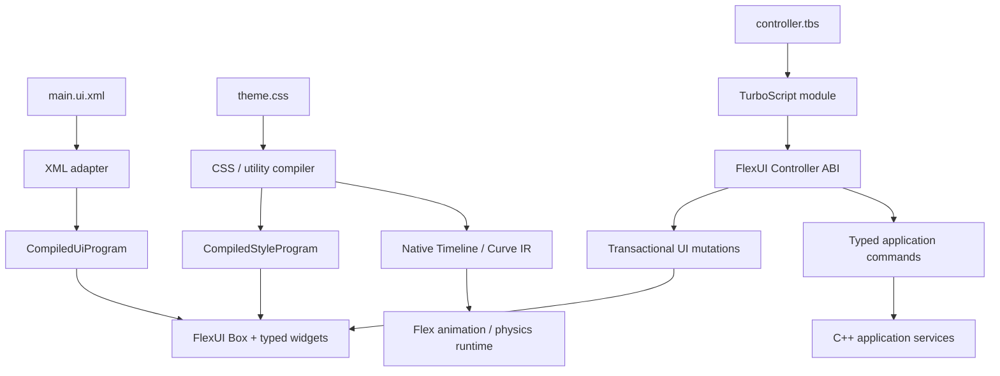
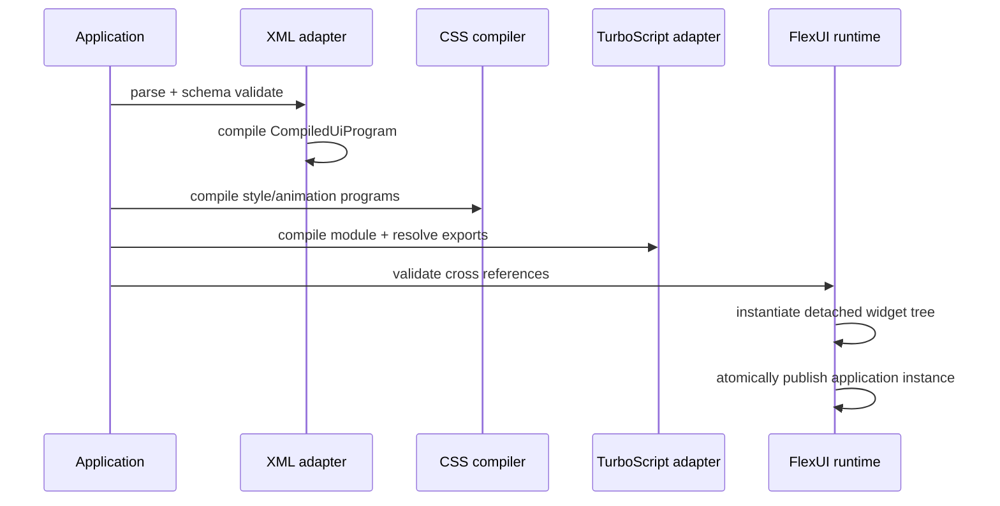

# FlexUI XML、CSS 与 TurboScript 架构决策

状态：架构决策已采用，实施与验收按下列工作项推进
日期：2026-08-31

## 2026-10-28 P4.4 M4b2 Box 内部真实运行时 Borrower 快照（Draft）

新增 `Box::inspect_subtree_borrowers(root)`，明确与编译静态归属
及真正的 `unmount(scope)` 分开：它在 Box 的 owner-thread，
只读扫描真实 live subtree，包含 Box-owned 节点与 Widget-owned
内部节点（不误把后者当作编译器生成节点），临时生成有界指针
identity set，用于检查 Focus、Hover、Active、Mouse Capture、
本地伪状态、Widget Host、实际 Binding Target、活动 Widget、
Keyed Repeater 与 Native Click Callback；同时报告 Box 的原生
事件 dispatch 和 layout/widget frame 正在借用整棵树的事实。

检查期间不回调 Widget、Script、Plugin，不消费 service mailbox，
不持久存储任何指针，不改动 binding 输入和代码生成状态。
失败（跨 owner-thread、staged/unmounted root、损坏的内部
父子链、内存不足）明确返回错误，不以缺失元素/借用计数 0
伪装资源释放完毕。Widget 内部 part 数量有明确 hard bound，
超过直接 fail-closed，不能无限递归。

这些状态只是在当前调用瞬间观察到的借用关系；即使全部 0，
仍然不构成 Widget/Binding 两向 observer 生命周期、
CompiledUiProgram 路由清理、端点 worker 已 join 或
safe-to-unmount 的证明。原来的 `compiled_program_installed_`
和物理结构删除门禁不被绕开。后续 Owner 协作提交仍在 #298/#275。

## 2026-10-28 P4.4 M4b1 编译来源对 live Box 的只读结构校验（已合并 PR #300）

[PR #300](https://github.com/qigao/stun/pull/300) 已合并至 master `a80c2af2`；原精确 HEAD `899c46be` 的 Windows/macOS `#40637148790`、Linux Sanitizer/独立 LSan `#40637148796` 与 Public dependency `#40637148784` 均成功，合并树与验收树一致。M4b2 的真实 Borrower 只读检查必须重新基于这一 master 完整验收。


`DesktopApplication::inspect_scoped_component_topology(scope)` 在当前
Box 的 owner-thread 上，按 M4b0 的编译器生成 root-child ordinal、
preorder parent/child index、匿名/非匿名 ID、tag、Widget 来源逐一查询
真实挂载节点，验证节点父级/ID 索引及结构子节点数量没有发生外部漂移。
每次查询只暂借一个有界的本地指针向量，函数退出立即释放，不形成
第二套可变 runtime owner registry，也不回调 Script/Plugin/Widget。

错误线程、非 Ready/活跃脚本 callback、未声明 scope、丢失节点、
Widget 身份不匹配、匿名节点位置改变、额外结构子节点均拒绝，
但其他 scope 的 Box、Widget/Bindings、服务队列不受影响。
特别是没有脚本事件的匿名 root/Widget 也可校验，不要求制造
`on:click` handler。reload 将账本与 Box 在一个现有 generation
事务中共同换代，新候选重新接受校验。

**本检查不是 unmount 许可证**：Widget 内部节点、Binding observers、
Focus/Capture、动画/布局借用，以及 plugin worker stop/join 都还需要
各自独立的有界生命周期门禁；对 Widget 内部动态 part 不伪造
静态编译节点，未来物理卸载必须在这些 owner 证明后执行。
详见 Issue #298，不能用这个只读检查绕开
`Box::compiled_program_installed_` 的原有严格拒绝。

## 2026-10-28 P4.4 M4b0 编译器来源确定的组件结构所有权账本（已合并 PR #299）

`compile_scoped_ui_components` 在静态合并阶段、`UiDocumentInstantiator`
进入 live Box 之前，为每一个唯一 `scope` 构造一份候选内只读结构账本
（`UiScopedComponentOwnership`）：明确的 base host ID、当前 host
内根节点 child ordinal、每个节点的 preorder parent index / child index、
scope-qualified ID（允许匿名节点无 ID）、tag、是否 Widget，以及是否
拥有编译后事件或 Binding source。源头只由合并编译器控制，
不会根据可伪造的脚本运行时事件 ID 猜测子树。

每个节点占一条有界记录，条目总数受原有 `max_nodes` 保护；无需为
深层匿名节点复制整条路径。只有 `compile_ui_definition` 与 Registry
全部通过才返回账本；失败的合并不能发布半成品。应用候选构建把
账本**移动**进唯一的 `PublishedApplicationState`，reload/recompose
随 Box/Program 一起整体换代，没有第二套可变运行时树。

这是静态编译来源证明，不是可直接释放的 `Element*`、Widget
租约或独立脚本 Owner。特别是没有事件处理器的匿名根/Widget，也须
能被追溯，而**不制造假事件路由**。后续 M4b 必须在真实 mounted
Box 中校验和保留物理资源 Owner、活动脚本/Binding/Widget 句柄、
focus/capture 与 host Worker join 证明，全部通过后才可进行原地
`unmount(scope)`，不能用仅有的编译静态路径绕过安全门禁。
跟踪 Issue #298；当前阶段不执行物理卸载。

## 2026-10-28 P4.4 M4a 作用域服务终态排空只读门禁（已合并 PR #297）

新增 `DesktopApplication::inspect_scoped_service_drain(scope)`，读取唯一
ScriptController 的精确 scope 事件退休标记与唯一服务队列当前代的
Reserved/Published/InFlight 租约和 admission tombstone，不复制所有权、
不提交命令、不消费 mailbox，也不回调 Endpoint。非 owner-thread、非
Ready/Mounted、未知 scope、原生事件正在冒泡均明确拒绝。

`queue_drained()` 只在「路由已退休、命令准入已关闭、此 scope 三类
请求租约全部归零」时为 true。即使 Endpoint 已经向 mailbox 发布
真实 `CANCELLED`，Owner 尚未消费时 `in_flight` 仍必须为 1。
真实 DSO/DLL worker 以及双 scope 测试验证：`sale` 的终态消费后
才视为队列排空；`sales` 同时独立保持投递资格且不会被误清除。
完整 reload 会重置门禁，新 generation 必须重新退休作用域。

**这个只读门禁不是 safe-to-unmount 证明。** 终态入队可能早于 worker
真正结束和 PluginHost stop/join；Box、Widget、Binding、native
callback/Observer、capability 和资源租约仍然受各自 owner 约束。
后续完整 `unmount(scope)` 只有同时具备上述独立生命周期证明后
才可执行。不能把 pending=0、取消请求已发出或路由已退休当作
资源已经回收。

## 2026-10-28 P4.4 M3d M2b 真实动态插件取消/完成/Join 门禁（Draft）

严格 v2 的测试插件 `cancel-watch` 在真正的 DSO/DLL worker 中查询
`host.cancel_requested(token_id, generation)`，只有观察到 exact-token
停止信号才从**插件自身**发布真实 `Cancelled`。真实
`DesktopApplication` 的两份 scoped XML 产生 `sale` / `sales`：
Controller 退休并静默队列后，`sale` 接收 Suppressed，
`sales` 继续通过原有 mailbox 接收 `Succeeded`，再执行真实
PluginHost stop/join 验证 DLL 生命周期；调用回调时不持有队列锁。
缺失租约的 `cancel-watch` 明确拒绝，不启动伪完成 Worker。

共享 `flexUI/tests/plugin-native-targets.cmake` 是仓库正常插件测试与
独立 installed-SDK Headless 测试的**唯一插件目标图**，不再复制两份
宏定义/路径/测试 fixture。Linux ASan/UBSan、独立 LSan 和 Windows/macOS
同时编译并运行真实 PluginHost / manifest / create unwind / C11 ABI，
保留 PTY/ConPTY；没有动态插件运行时证据不可合并或宣称取消已完成。
**即使本测试成功，仍不代表所有插件按请求取消能力已经验证。**
[PR #295](https://github.com/qigao/stun/pull/295) 已以 `750b951b` 合并至 master，验收 feature HEAD `eaff4490`。
其完整 Windows/macOS、Linux ASan/UBSan 与独立 LSan、Public dependency 均通过。
本 M2b [PR #296](https://github.com/qigao/stun/pull/296) 基于该合并 HEAD
重新提交为 `2871188e`，保留真实 DLL/DSO 测试与 Windows
`test_plugin_create_unwind` 的等价断言修复；只有其自身精确 HEAD 的
完整原生矩阵通过后才允许合并。不得以 M2a 的绿色 CI 替代 M2b。


## 2026-10-28 P4.4 M3d M2a 单一插件 ABI v2 的 exact-token 取消查询（已合并 PR #295）

`plugin_abi.h` 与 PluginHost 使用唯一 C11 ABI 2.0、入口
`flexui_plugin_get_api_v2`。宿主函数表在 `post_completion` 之后
公布 `cancel_requested(context, token_id, token_generation, out, error)`；
对活跃精确 Token 只读查询原有的 `ApplicationServiceCancellationLease`。
正常返回 0/1、失效或未知 Token 返回 STALE、缺少原生取消租约返回
REJECTED，正在发布终态返回 BUSY，不会伪造 Cancelled 或创建第二个
状态机；插件结束由它自己报告终态，host 仍依据真实 join 才卸载库。
ABI v1 不受理也不尝试旧入口，仓库内 C 示例与测试插件同步机械迁移。

本阶段的生产 `plugin_module.cpp` 和独立 C11 PluginSDK ABI 测试、
真实插件样本源码必须在 Linux Sanitizer 与 Windows/macOS Headless
中编译；运行时 DLL 加载、跨 DLL worker 取消与 stop/join 竞态将在 M2b
单独正式验收。**仅源码编译不能宣称插件协作取消已完成**。

## 2026-10-28 P4.4 M3d M1 原生服务请求只读协作取消租约（已合并 PR #294）

在生产 `ApplicationServiceRequest` 中增加由唯一
`ApplicationServiceRequestQueue` 创建的 exact-token/generation
`ApplicationServiceCancellationLease`（由服务端只读共享持有）；
`requested()` 跨线程原子读取，只有队列拥有信号写权限。
所有租约分配在 Reservation 私有 staging 内完成，失败不修改活动 Slot。
InFlight 作用域静默退出只写停止请求标志而**不释放 token**、
**不制造 Cancelled 完成消息**。整代 reset/close 同样对仍存活租约
发出协作停止信号；正常完成并不伪装成取消。

Native C++ Endpoint 可以自主观察该标志、停止自己持有的工作后，
用原始 token 经同一 ApplicationCompletionMailbox 发布真实终态，
再由 Owner 消费并释放请求表槽位。测试验证异步端点、兄弟作用域、
实际 Cancelled/Succeeded、越代关闭、跨线程可见性和所有权。
这只是**原生 C++ 服务端的协作信号传输契约**；
`flexui_plugin_api_v1` 尚不传输 lease，插件不能据此宣称取消支持，
插件 ABI 变更与全部服务资源/Join 生命周期仍在 Issue #292。
不允许用本地 Suppressed 状态代替真实 worker 完成。

## 2026-10-28 P4.4 M3d M0 服务端取消前置 Native 门禁（已合并 PR #293）

将已有真实生产 `ApplicationServiceRegistry`、
`ApplicationCompletionMailbox` 与 `ApplicationServiceDispatcher` 的
原生 CTest 统一纳入 Linux ASan/UBSan、独立 LSan 以及 Windows/macOS
Headless 必跑矩阵，不使用模拟的 ServiceDispatcher/第二个完成队列。
增加真实 scoped XML 事件 → ScriptController → 应用队列 → Dispatcher →
Endpoint → completion 回归：精确退出 `sale` 后，尚未交付到宿主的命令
必须被取消，`sales` 的命令仍按 FIFO 交付并接收真实完成消息。

**本阶段仅加强端到端验证，不能宣称已实现 endpoint cancel。**
InFlight 请求仍需真实端点的精确 token 协作取消与终态证明；
插件 C ABI v1 无此接口，不能以全局 stop/join、丢弃完成消息或
队列 `Suppressed` 作为 worker 已停止的证据。契约单独记录在 #292，
`unmount(scope)` 继续由 #275 跟踪。

## 2026-10-28 P4.4 M3c 应用层安全准入门禁（已合并 PR #291）

单个 DesktopApplication 可调用
`quiesce_retired_scoped_service_requests(scope)`，但**只能在**
`retire_scoped_event_handlers(scope)` 成功后调用；唯一
ScriptController 暴露自己已持有的退休标记只读查询，
应用先验证合法注册作用域、Mounted+Ready+owner-thread、
事件/脚本不重入，才委托队列执行私有 M3b 排空。
返回的 `newly_suppressed_in_flight` 是**本次刚标记**的请求数，
而不是宿主仍运行任务的总数；重复幂等调用将返回 0，不能作为
组件资源已经安全释放的证明。

这不是把两步伪装成单一跨 Owner 原子提交：第二步失败时已退休
事件路由仍保持不变，可在租约安全后重试；不撤销/恢复任何 script
回调状态。Scope 内已发到宿主的请求仍保持直到真实 completion；
**不会提前卸载 Element、Binding、Widget、能力权限或服务资源。**

## 2026-10-28 P4.4 M3b 私有作用域命令队列有界静默排空（已合并 PR #290）

新增私有 ApplicationServiceRequestQueue::quiesce_scope_requests(scope)，先
检查 owner-thread / 有界 scope、拒绝该 scope 尚有的 Prepared 预约，
验证整个已发布 FIFO，再预分配已关闭来源集合；提交后不再允许此来源预约。
未发送到服务端的 Published 请求在原队列环中稳定压缩和取消，
其他 scope 保持 FIFO 顺序。已经交付宿主的 InFlight 请求绝不伪装为
已取消：保留 token 到真实完成时，释放槽但返回显式 Suppressed 状态，
不向脚本回调投递；GCanvas 主机有界 pump 在存在脚本 completion 处理器时继续取后面的
有效 completion，防止被抑制的结果阻塞同一脚本队列。没有该处理器时
保留原有 raw mailbox 轮询权，宿主不能擅自吞掉用户的 completion。
整代 reload 重置来源门禁。

M3b 还将真实 `gcanvas_window_host.cpp` 作为独立 Object 源码目标纳入
Linux（ASan/UBSan + LSan）与 Windows/macOS Headless 构建矩阵；
这验证生产 WindowHost 的编译接口，但**不声称**已运行真实 GPU
窗口或可选 WindowHost 事件循环行为测试。

**仍未实现真实 Service Endpoint 的协作取消、host 资源租约释放及
完整原地 unmount(scope)。** 此片独立验证队列端排空/消息抑制，不得
以此作为外部执行已结束的证明。

## 2026-10-28 P4.4 M3a 作用域服务请求来源与租约快照（已合并 PR #289）

真正命中的编译事件处理器由唯一 ScriptController 在脚本返回后、命令预约
前写入只读来源（`scope::local_id` 的 scope，而非可伪造的脚本命令字段，
也不是事件冒泡原始 target）；全局 frame / service completion 回调
来源为空。ApplicationServiceRequestQueue 在预约事务的私有暂存阶段复制来源
字符串，保持 Reserved / Published / InFlight 身份；只读
`inspect_scope_leases(scope)` 检查精确作用域和 owner-thread，覆盖相邻
scope、出队、completion、generation reset。

**本阶段不取消宿主正在运行的工作，不吞掉迟到 completion，也不允许
组件动态卸载**。后续需另行证明协作取消、completion 抑制及资源租约安全，
才能进入真正 in-place `unmount(scope)`。

## 2026-10-28 P4.4 M2 作用域脚本事件路由事务性退休（已合并 PR #288）

新增 `ScriptController::retire_scoped_event_handlers(scope)` 和
`DesktopApplication::retire_scoped_event_handlers(scope)`，从当前 Controller
的**唯一活动执行路由表**中原子退休该 `scope::id` 下的所有脚本事件导出，
不修改不可变 `CompiledUiProgram`。先验证 scope ASCII 规则、完整匹配
的编译事件和全部可用路由，再独立构造下一张路由表与退休标记，通过
no-throw swap 完成提交，杜绝半套分发表。相邻 scope 精确隔离，
重复退休幂等，脚本事件及原生事件冒泡重入拒绝。原生 Bridge 只查询
Controller 的活动路由，下一代完整 reload/recompose 重建活动分发表。

**仅撤销脚本事件执行资格**，不删除 Element、Binding、Widget、异步服务
请求、Service Completion 或组件资源。它不是 `unmount(scope)`；
已合并 #285 的整代组件重组仍是完整移除脚本组件的权威路径，
真正作用域异步租约回收与资源所有权继续由 #275 跟踪。

## 2026-10-28 P4.4 M1 结构子树及其 Binding 所有权原子退休（已合并 PR #287）

本轮增加 `Box::retire_bound_structural_subtree(id)`，显式处理手工管理的
**结构子树和它独占的 Binding target 记录**。Box 的既有预检完整验证
节点归属、编译程序、脚本事件、Widget、租约、线程及活动指针，并确认
UiBindingRuntime 没有正在执行的 `update` 或安装事务。提交时先解除本子树
Binding 所有权键及依赖表，**不把值恢复到将要析构的 Element**，
再执行无分配的子树回收。未删除兄弟节点和其 Binding 不受影响，
应用级输入仍由原单一 `UiDataContext` 持有；旧 BindingHandle 失效。
拒绝回调、Widget value observer 和全部 `CompiledUiProgram` 实例。

现有 `retire_unbound_structural_subtree` 仍是仅无 Binding 子树的严格入口。
M1 也**不是**动态 XML 组件 `unmount(scope)`，因为不能擅自修改不可变
事件表、Controller、服务完成/租约或组件资源。此边界仍由 #275 后续追踪。

## 2026-10-27 P4.4 M0 有界 Box 子树回收（已合并 PR #286）

此阶段先为 Box 添加 `retire_unbound_structural_subtree(id)`，提供
**真正原地删除**应用自有结构子树的底层生命周期原语。执行前完整审计
Box 所有权、父子指针、ID 索引、Binding 目标、Widget、编译事件属性、
鼠标/键盘活动指针、Element 原生 ClickCallback 与事件分发深度；
任何一个条件不满足都必须拒绝。
成功后撤销索引、清理 CSS/动画/过渡缓存，所有旧 `UiHandle` 失效，
不改变未删除兄弟节点的对象地址和 generation。

已经由 `UiDocumentInstantiator` 挂载了不可变 `CompiledUiProgram` 的 Box
也一律拒绝此底层操作：否则即便目标节点没有绑定，程序的静态定义也会
与运行时树分叉。M0 的准入还要求由 Box 构造线程执行。
**严禁**把这个 M0 API 直接当成已有脚本组件的通用 `unmount(scope)`：
它不修改编译期 `CompiledUiProgram` 的 handler/binding 清单，也不承担
外部 service lease 或 pending callback 的取消。带有 Binding、Widget
或 on: 事件的组件仍拒绝原地销毁；这些能力属于 P4.4 后续门禁。
当前已合并的整代重组 #285 继续作为需要完整组件功能时的权威路径。
没有新增 UI Owner、DOM/BytesVM、fallback。

## 2026-10-27 P4.3 整代组件集合重组（已合并 PR #285）

P4.2 已通过 #284 合入 master。P4.3 引入
`DesktopApplication::recompose_scoped_xml_components(components, input_aliases)`，
**显式**传入新的完整组件列表与绑定别名列表。它重用现有
`DesktopApplication::reload` 的候选装配→校验→服务/完成端口 generation 结算→
单次 `Box`/Controller 原子切换流程。添加、更换或移除 scope 都通过
完整应用 generation 更新；新程序中的事件和 Binding 表在挂载前统一编译，
旧组件随整个前代 `PublishedApplicationState` 回收。

它不是运行中对原有 Box 的子树就地 detach/remove，不承诺保留组件内瞬态
state，不引入逐组件异步取消或独立脚本上下文。传入的映射必须全部显式，
且目标仍是已声明的 application-global `UiDataContext` 种子输入。
失败回滚必须保持旧代可操作与配置不变，成功后标准 `reload` 继续沿用
新的集合。必须以真实作用域 Event/Effect、Typed Binding、generation、
异常失败及 Windows/macOS/Linux 原生 SDK 测试验证。

## 2026-10-27 P4.2 静态组件显式输入别名（已合并 PR #284）

P4.1 已通过 PR #282 合入 master。本轮为复用的 XML 组件增加编译期、
**显式**输入映射。例如模板中 `bind:text="$caption"`，可用
`builder.scoped_binding_alias("sales", "caption", "sales_caption")`
将此处源绑定到 `builder.binding_input_string("sales_caption", "Revenue")`，
而第二实例 `costs` 可以选择另一个声明的输入。布尔/数值 MIR 表达式亦可
对完整变量名做定向重写，字符串字面量与函数名不受改写。

组件不会获得独立的 `UiDataContext`；全部输入由单一应用 Box 持有。
未知作用域、缺失已声明的应用输入、重复或未使用的映射均拒绝。完整 reload
仍从显式种子值创建全新候选；动态 mount/unmount、私有输入生命周期、
资源所有权和安全能力隔离仍属后续工作。

## 2026-10-27 P4.1 组件作用域（已合并 PR #282）

此阶段基于已合并的 Chart/Infographic/DOT XML 事务装配与完整 DOT
源码→GraphLayout→Widget 测试。PR #282 已合并；以下为已验收契约。

- `DesktopApplicationBuilder::scoped_xml_component(scope, host_id, xml)` 仅在应用
  **首次挂载/完整 reload 前**组合组件；宿主必须是根 XML 中已存在的结构节点。
  各个组件的 `id="action"` 编译为 `sales::action` / `costs::action`；
  事件、binding 目标、`for`、局部 `href="#id"` 和 ARIA IDREF 同步限定作用域。
  普通 XML 属性与 `attr:` 命名空间形式都处理同一个 IDREF 规则，二者同时
  声明同一语义属性会拒绝，避免不受作用域约束的值覆盖安全值；外部 URL 不改写。
- 所有 `on:*` 事件归于**同一个** `CompiledUiProgram` 和 `ScriptController`；
  UI Mutation / Application Command 仍按原本预留→提交→发布的顺序进行。
- 对跨实例输入共享采用**显式应用级**声明，例如
  `builder.binding_input_string("caption", "Ready")`，在 UI 事务挂载前创建
  `UiDataContext` 的类型化输入。组件的 `bind:text="$caption"` 指向该应用级输入；
  两个组件若要独立值应声明不同输入名称，而非假定存在隐式组件私有数据源。
  还提供 `binding_input_number` 和 `binding_input_bool`。配置中的同名输入、
  超限字符串、非有限数字、与 Binding 不匹配的输入类型在候选发布前拒绝。
  布尔/数值输入可供编译后的 MIR 表达式使用；成功 reload 会按声明的初始输入
  重新构建候选，运行中修改的输入值**不会被隐式继承**，应用如需保留状态应显式重放。
- `slot` 保持实例局部语义，静态组合仅把重复的 slot 降为 `data-slot`，
  不在全局建立重复 Slot 键。每个节点的真实身份仍归 Box 唯一索引管理。
- **禁止**动态逐组件脚本注册/卸载、组件独立权限、安全隔离、未声明资源跨实例
  共享与动态 input 自动命名。这些需要额外的生命周期与所有权契约，
  不能仅凭作用域 ID 或一个通过的渲染测试放行。

这个方案继续使用原生 XML + StyleEngine/TailwindCSS JIT + TurboScript Host ABI；
没有 BytesVM、浏览器 DOM、WebView 或第二份 UI 树。

## 2026-10-22 实施范围与目标契约

以下区分已合并源码与长期设计；后文的架构决策不代表全部能力已经验收。

| 边界 | 当前事实 | 尚未完成 |
| --- | --- | --- |
| Text/Unicode | #76/#77/#78 已合并：XML 完整字节视图严格准入、Unicode 17 emoji 属性与呈现策略分离、字素级近似宽度/间距；事实与边界来自 `Salts::Unicode` | 真实 shaping/glyph advances、测量接入、编辑几何、完整应用字符串边界；见 [#15](https://github.com/qigao/stun/issues/15) |
| XML | #12/#13/#14 提供注册内容模型预检、匿名节点、自然文本与严格 UTF-8 准入 | 完整 property/event/binding schema、稳定内部身份、精确解码文本 source map 和有序混合内容；见 [#16](https://github.com/qigao/stun/issues/16) |
| CSS/Tailwind | 当前 catalog/JIT 生成 CSS 并进入同一个 StyleEngine cascade | 固定的 Tailwind v4 compatibility profile 与完整声明范围；见 [#17](https://github.com/qigao/stun/issues/17) |
| Application | detached candidate 与 owner-thread publication/reload；真实无窗口 XML/registry/application 测试验证预检及失败回滚 | 真实 TurboScript JIT、完整 desktop/editor、安装分发及跨平台验收；见 [#31](https://github.com/qigao/stun/issues/31) |

### Text / Unicode 目标契约

公开字符串边界的目标编码是严格 UTF-8；非法输入应返回结构化错误，不静默替换。
已验证的合法 bytes 保真，不隐式执行 NFC/NFD normalization。source/storage offset 以 byte
表示；cursor/delete/selection 等用户可见操作应遵守 extended grapheme boundary，此项尚不能
视为所有编辑控件的已完成行为。

Unicode scalar、版本化 property、grapheme/word/line-break/bidi 基础事实由独立
`Salts::Unicode` 提供；FlexUI 不维护第二份 Unicode 数据表。CSS typography、段落布局、
font shaping/measurement、glyph 与 GPU font resource 分别属于其上层边界。
`approximate_text_width()` 仍是近似值；字素计数正确并不构成真实字形测量。

### XML typed schema 目标契约

目标 descriptor 区分 structural/container、leaf/content widget、composite widget、text 和
后续 reusable component，并声明 properties、events、bindings、content model 和可选 factory。
非法组合应在带 source location 的 compiler/registry 边界拒绝；不能只在 paint 时发现错误。

已实现的自然文本与匿名节点写法例如：

```xml
<label>保存</label>
<button id="save" on:click="save">Save</button>
```

事件示例要求外围 `ui` 声明 `xmlns:on="urn:flexui:event"`。匿名结构或控件节点不进入名称索引，
也没有公开 `UiHandle`；稳定内部 reconciliation identity 尚未完成。公开 handle 仍基于显式 ID
与 generation，事件及 binding 目标必须有显式 ID；显式空 ID 仍报错。

自然文本按顺序合并 PCData/CDATA，只裁剪两端 XML 格式空白；文本与元素子节点混排明确报错。
实体解码及裁剪后的文本诊断锚定首个原始贡献文本节点，`SourceSpan.length == 0` 不表示已实现
精确原始范围映射。当前内容模型只覆盖注册 tag、文本许可与子节点数量，不等于完整控件 schema。

格式编译器产出结构程序；canonical application 与带 registry 的实例化先完成整树内容预检，
再调用工厂或修改 Box，应用在加载 CSS 前也完成预检。无 registry 的重载保留为显式通用 Element
兼容入口，不代表已通过 typed schema；统一的 registry-aware 公共编译 API 仍由 #16 跟踪。

### Tailwind compatibility 目标契约

目标 authoring surface 是标准 `class="..."`，普通 semantic class 与 Tailwind candidate 共存，
utility 只生成进入同一个 cascade 的规则。固定 Tailwind v4 profile 后，逐项声明 utility、
variant stacking、responsive、dark、data/aria、container query、theme 与 arbitrary syntax 的
支持范围；识别但不能表达的语义应明确报 Unsupported，不重新解释为本地不同语义。

官方 Tailwind compiler 可作为开发期 differential oracle，不作为安装后的 Node/npm 依赖。
`utility_whitelist.json`、`UtilityCatalog` 与 exact-token lookup 继续作为当前实现及 coverage 数据，
不能据此声称完整 Tailwind v4 兼容。只有 profiling/benchmark 证明必要时才考虑直接 Style IR lowering。

## 背景

FlexUI 需要形成类似 Qt `.ui` + QtScript 的桌面应用开发模型，但不引入浏览器 DOM、JavaScript
运行时或 npm 生态。现有 `.flex` DSL 同时承载 UI、动画、状态机、资源和表达式，导致文档结构、
交互语言与动画运行时的职责重叠，也让 `Flex::Compiler` 成为 FlexUI 的构建依赖。

## 决策

- XML 是 UI 结构与静态属性的唯一源格式。
- CSS 是视觉、状态样式、transition 与 keyframes 的同一个 cascade；Tailwind utility 编译到该 pipeline。
- TurboScript（TBS）是交互、应用状态和命令编排的唯一可执行脚本语言；TBS 不创建或遍历一个
  通用 DOM，也不逐帧驱动动画。
- Flex 的原生 Timeline、Track、Curve、显式三次贝塞尔、Physics/Box2D 和数值 MIR 保留为运行时
  能力；它们不属于要删除的 Flex DSL。
- `.flex` parser、lexer、AST、binary DSL format 和 `Flex::Compiler` 在迁移完成后删除。
- XML、CSS 和 TBS 都先编译为不可变程序，再在 UI owner thread 上实例化或执行。



## 职责与状态归属

| 层 | 主事实源 | 可变性 | 错误边界 |
|---|---|---|---|
| XML adapter | XML source | load/reload 时可替换 | 语法、schema、source location |
| `CompiledUiProgram` | UI definition、事件和 binding 表 | 不可变、可共享 | 语义、资源上限、重复 ID |
| CSS compiler | stylesheet source | load/reload 时可替换 | selector、property、animation 引用 |
| Box/widget tree | 已实例化 UI 状态 | 仅 UI owner thread 修改 | mutation commit |
| TurboScript controller | controller locals | 仅 controller owner thread 修改 | ABI、limits、handler export |
| Timeline/Physics | 动画与物理状态 | runtime owner thread 修改 | 非法参数、缺失 target、资源上限 |

TBS 的一次事件返回一个不可变 effect envelope。宿主先完整校验 `mutations` 与 `commands`，再提交；
校验失败时 Box 与应用服务都不得观察到部分结果。动画的长期状态由原生 runtime 持有，TBS 只发送
类型化的 `play`、`pause`、`seek`、`set_parameter` 等命令。

## 编译与装载顺序



任一阶段失败都立即返回结构化错误。旧实例在 reload 成功提交前继续作为唯一活动实例；不进行静默
降级，也不混用新旧文档的部分产物。

## 当前 XML 实现契约

XML adapter 只负责格式适配，不持有业务状态。元素名称通过 `WidgetRegistry` 映射到具体 widget
factory；typed load 拒绝未知 tag、重复非空 ID、重复属性及已有受约束属性的类型错误。完整的
逐控件属性 schema 尚待 #16。通用属性映射到
`UiNodeDefinition::properties`，事件使用 `on:*`，binding 使用 `bind:*`，命名空间在 adapter 边界
转换为现有 canonical key（如 `on.click`、`bind.text`）。资源使用独立、受限的 `<resources>` 区域，
最终产生 `UiResourceDefinition`。

XML 解析采用仓库 vcpkg manifest 已声明的 pugixml，并通过其 CMake imported target 隔离在 adapter
实现内；公共头不暴露 pugixml 类型。上游接口与解析行为参考
[pugixml manual](https://pugixml.org/docs/manual.html)。

`WidgetRegistry` 是实例化的唯一工厂事实源。内置 widget 在启动时显式注册；插件只能通过版本化
宿主接口注册 factory，不得把第三方类型或 native pointer 写入 XML IR。

当前 `WidgetRegistry::builtins()` 显式注册：

- 结构元素：`div`、`span`、`main`、`section`、`article`、`header`、`footer`、`nav`、
  `aside`、`form`、`fieldset`、`legend`、`p`、`a`、`ul`、`ol`、`li`、`window`、`view`、
  `box`、`content`。
- 基础控件：`button`、`label`、`input`、`checkbox`、`radio`、`switch`、`slider`、
  `progress`、`textarea`、`select`、`image`。
- 组合控件：`tooltip`、`modal`、`tabs`、`badge`、`spinner`、`divider`、`toast`、
  `dropdown`、`accordion`、`calendar`、`table`、`tree`、`colorpicker`、`group-button`、
  `toggle-group`、`avatar`、`card`、`breadcrumb`、`pagination`、`stepper`、
  `gradient-editor`、`markdown`。

基础控件 factory 消费已类型化的常用属性，例如 `text`、`value`、`placeholder`、`disabled`、
`checked`、`min/max/step`。类型不匹配返回 `WidgetFactoryFailed`。Registry 通过实例化入口显式注入；
不带 Registry 的旧入口继续创建通用 `Element`，只用于迁移兼容。

## 表达式策略

短期保留现有数值 MIR 作为 CSS animation、binding 与原生 runtime 的编译后执行后端。这不是保留
Flex DSL：用户不再编写 `.flex` 文档，MIR 也不负责 UI 结构或事件编排。

如果后续要求所有表达式都使用 TBS 语法，应在 TurboScript 仓库提供受限的 pure-expression profile：
禁止 I/O、宿主调用、分配和循环，编译一次后通过类型化输入槽执行。该能力可替换表达式前端，但不应
让完整 TBS VM 进入每帧逐属性热路径。在 TurboScript 提供并通过数值一致性与 benchmark 验证前，
不得假定该 API 已存在。

## 兼容性与迁移

迁移期间采用双前端、单 IR：旧 `.flex` parser 与 XML adapter 都只能输出同一个
`UiDocumentDefinition`/`CompiledUiProgram`，后续实例化、binding、事件和测试完全共享。双前端是有
移除期限的迁移机制，不是长期公开能力。

删除旧 DSL 的门槛：

1. FlexUI、FlexPlayer、examples、FlexChart 与工具中的 `.flex` 消费者均已迁移或明确移除。
2. XML 对 UI tree、属性、事件、binding 和资源具备等价测试。
3. CSS/native runtime 对仍需保留的 animation、curve、physics 行为具备回归测试。
4. 安装树不再导出 `Flex::Compiler`、`Flex::DSL` 或 DSL headers。
5. 全仓库 configure/build/test 和 install-tree consumer 验证通过。

回滚以 frontend feature 为单位：XML 成为默认后，旧 parser 可在一个发布周期内由显式兼容选项启用；
它仍输出相同 IR，不维护第二套 runtime。删除 release 之后的回滚只能恢复独立的兼容分支或版本，
不能在主线重新引入双事实源。

## 当前实现与风险

- `事实`：`DesktopApplicationBuilder::xml_entry()` 已是默认入口，并默认注入
  `WidgetRegistry::builtins()`；TurboScript 通过 `ScriptModuleFactory` 注入，因此 Core 公共边界不暴露
  TurboScript 类型。候选只有在 strict CSS、typed widget、required export 与 mount 全部成功后发布。
- `事实`：`DesktopApplication::reload()` 在 owner thread 构建完整候选并一次交换；失败保持活动
  Box/program/controller，跨线程调用返回 `WrongThread`。
- `事实`：`DesktopApplication::dispatch_event()` 已将 hit-test、widget consumption、native callback、
  target→ancestor bubbling 与 controller 串成同步 owner-thread 链路。被 widget 消费的事件默认不进入
  脚本；成功 click 快照同时包含原始 `target` 与绑定节点 `current_target`。
- `HIGH`（事实）：多个工具、示例和模块仍直接消费 `.flex`；立即删除 parser 会破坏公开构建与示例。
- `MED`（事实）：当前 XML event schema 尚未提供“即使 widget 已消费也发送只读通知”的显式选项；
  focus/capture 的完整组合矩阵也仍待补齐，因此 consumed event 统一 fail-closed 为不进入脚本。
- `MED`（事实）：DesktopHost/native window、plugin service 与 application package loader 尚未进入
  当前 Facade；现有实现验证的是 headless application candidate 事务。
- `MED`（推论）：完整 TBS VM 若逐帧求每个属性，会增加调用、分配与 ABI 成本。依据是当前架构的
  per-frame native Timeline 热路径；需以 benchmark 决定是否增加 pure-expression profile。
- `LOW`（常用做法）：XML/CSS/TBS 的职责分离更接近成熟桌面 UI 工具链，但本决策的主要依据仍是
  仓库现有 IR、runtime 与 controller 边界，而不是形式相似性。


## 2026-10-28 P4.4 M4b4a — Binding-owned value observer lease (Draft #302)

A bidirectional `bind_value` callback used to capture its raw UiBindingRuntime and
was only unregistered from the Widget's live observer vector. Both native
InputWidget and TextAreaWidget copy that vector for notification, so a
callback that was already copied could still execute after `unbind`.

The one Binding runtime now retains a shared **retirement lease** with each
value observer. A copied callback checks its lease before touching the runtime;
a live callback holds an active-call guard until it exits. `unbind` and
`clear` refuse/throw during an active owned value callback; rollback,
destruction, restoration and future doomed-target discard retire the lease
before the Binding record is removed. The Box's read-only subtree snapshot
reports owned value observers, active/blocked leases, Binding mutation and
ownership inconsistencies without creating a second ownership index.

This proves ONLY Binding-owned callback retirement readiness. It does not
inspect arbitrary third-party Widget listeners, release a live Widget, join an
endpoint/PluginHost worker, remove the installed compiled program, or authorize
`unmount(scope)`. `Box::retire_bound_structural_subtree` still refuses
Widgets and any installed compiled program. M4b4's remaining Widget-owner
contract, M4b5 independent scope worker join and M4b6 atomic physical detach
are separate mandatory gates under #298/#275.


## 2026-10-28 P4.4 M4b4b — Widget observer frame diagnostics (Draft #302)

InputWidget and TextAreaWidget report the complete registered editable-observer
count and notification-frame depth through `inspect_edit_observers`. The depth
covers the copied notification batch and unwinds even on exception. The
single Box borrower snapshot compares actual Widget listeners to Binding-owned
leases, exposing external/unowned observers, active notification frames and
uninspectable third-party text Widget adapters (fail-closed).

This is independent read-only evidence, NOT an observer disconnect, PluginHost
join, or permission to remove compiled Elements. Other non-text Widget owners
still require their own lifecycle evidence. #298/#275 remain open.


## 2026-10-28 P4.4 M4b5 — sole mandatory Plugin ABI v2.1 scoped JOIN (Draft #302)

The one `flexui_plugin_get_api_v2` now requires ABI minor **1** and an
explicit `join_scope` callback: neither old v2.0 nor a separate provider
may silently fall back. The one `ApplicationServiceRequestQueue` owns the
compiler-derived `origin_scope` and copies it into its exact-token
cancellation lease before any slot publication. PluginHost hands only its
borrowed byte view to a native plugin's `submit`; a worker must copy it.

`PluginHost::join_scoped_workers(scope, timeout)` validates the owner thread,
current Started host, bounded compiler-scope grammar, and no unposted
exact-scope service terminal before calling each plugin's independent
`join_scope`. On BUSY or TIMED_OUT the provider and DLL remain live for
retry. This never triggers global plugin `stop`, joins `sales` when
asked for `sale`, or consumes a terminal.

A REAL dynamic plugin fixture retains a cooperative `sale` worker
**after** posting CANCELLED and after the application's queue_drained becomes
true. Scoped join must time out until a separate test-only native release
signal arrives. The independent join then succeeds, the shared PluginHost
remains Started, and sibling `sales` has received its completion.

**Not sufficient for physical unmount:** this only certifies this trusted
PluginHost's workers at a point in time. Full application admission
quiescence + queue terminal consumption, native non-plugin endpoint lifetime
proof, ALL Widget/Binding leases and an atomic compiled-subtree disposal
transaction are still mandatory. No `unmount(scope)` on #302; keep #298/#275
OPEN and Draft unmerged.


M4b5's native scoped-worker acceptance also re-dispatches a fresh
`sales::action` after `sale` has independently joined and asserts the
actual second completion, script request ID and payload. The shared module
remains Started; this is not a plugin-wide stop and not a same-content
fixture mock.

## 2026-10-28 P4.4 M4b5c — eventless scope route retirement admission (Draft #302)

The application validates its compiler-authored exact-scope topology against
the **live** Box before retiring script routes. A component with zero event
definitions has no routes to unregister. Only DesktopApplication may request
the existing ScriptController's private compiler-attested zero-route marker;
the public Controller API still refuses unknown/zero-route scope names.
The same marker is required before quiescing service admission, and resetting
the application generation rearms it.

A scriptless XML component has no Controller or script command producer. Its
zero-route retirement is therefore vacuous, but its scope must still match
the compiler's mounted Element/Widget ledger before queue quiescence, and the
read-only drain reports this independently from admission retirement. Neither
case creates a fake event binding, a second Controller, or a new owner registry.

Native tests exercise anonymous roots, real Widget, sibling active events,
wrong/foreign scope rejection, same-generation idempotence, and reload reset.
The low-level Box compiled_program guard remains unchanged: NO physical
\`unmount(scope)\` has been granted. Plugin/native endpoint joins and
Widget/Binding disposal remain independent mandatory gates.

## 2026-10-28 P4.4 M4b5d — native Endpoint join proof (Draft #302)

The sole immutable ApplicationServiceRegistry now provides
`join_scoped_resources(scope,timeout)`: it checks each DISTINCT registered
endpoint once (shared capabilities do not double-join) and requires explicit
`IApplicationServiceEndpoint::join_scoped_resources` evidence.
The default is **Unsupported**, never implicit success. Busy/unsupported
providers block complete retirement even when the application queue has
consumed its terminal records. The PluginModule implements the same C++
contract via its existing strict v2.1 `join_scope` and additionally checks
module-owner thread affinity.

The registry method neither consumes completions nor changes any Box state,
and successful joins are NOT proof of an application-scoped route/queue
quiescence or native UI detach. The future application-owned retirement
preflight must compose these independent gates on its one owner thread
in the correct order. No second runtime registry, no provider fallback, and
`unmount(scope)` remains unimplemented.

## 2026-10-28 P4.4 M4b5e — app-owned native Endpoint join proof (Draft #302)

The same application validates current-generation compiler scope ownership,
retired routes, a quiesced service request queue and actual consumed terminal
count before calling `join_scoped_service_resources(scope,timeout)` on the
one immutable registry. Missing C++ provider contracts fail closed; the Plugin
endpoint reuses its mandatory ABI v2.1 join. After provider calls, the app
rechecks generation and queue tombstone, rejecting reentrant reload.

The returned result certifies only service worker retirement, not Widget or
Binding observer teardown, physical deletion, DLL unload or safe unmount.
No `unmount(scope)` implementation; #302 Draft, #298/#275 Open.

## 2026-10-28 P4.4 M4b5f — no stale token re-admission after scoped JOIN

The authoritative queue's existing cancellation lease now has a separate
atomic `retired` bit, set on every real terminal consumption or slot
discard BEFORE the queue drops ownership. This is distinct from a cooperative
`requested` cancellation signal. Native PluginModule checks the existing
lease's exact token/generation and refuses stale/retired/cancelled requests at
submission, so a copied host request cannot start new work for an already
drained and joined scope after terminal consumption. No second token-owner
registry, raw pointer persistence, retry or alternate provider was added.

Queued lease retirement is still NOT external worker exit. Physical unmount
still requires the separate exact-scope provider JOIN, Widget/Binding lifetime
and no-throw physical subtree commit; #302 stays Draft and unmerged.

The native DSO/DLL acceptance now drives **the actual application facade**
`join_scoped_service_resources`, not merely `PluginHost` directly:
before script-route retirement it refuses; after real terminal consumption
the deliberately still-live worker makes Registry report EndpointJoinBusy.
Only a separate provider release permits a returned generation and exact
joined provider count; the sibling `sales` continues to publish another
real service request afterwards. No `unmount(scope)` is implied.

## 2026-10-28 M4b5h — retain faulted Controller error contract

Exact-head CI on 32be0299 found one real cross-platform RED in
`test_desktop_application`: moving the live compiler-topology check ahead of
Controller state validation caused a faulted script module to report a plain
DesktopApplication InvalidState, dropping the historical nested
`ControllerErrorCode::InvalidState` with EventRetirement stage.
The application now preserves the Controller's original fail-fast typed error
before the read-only topology check whenever the controller is not Mounted.
This does not retire routes, synthesize an eventless handler or change the
Box owner graph. Native regression asserts the exact nested code/stage,
unchanged live Element handle and absence of a retired marker.

## 2026-10-28 P4.4 M4b6a — read-only transition/animation/cache owner scan (Draft #302)

The Box borrower snapshot now enumerates the actual mounted subtree's
Box-owned nodes and its real Widget-internal child Elements, rejecting
foreign host ownership and Widget pointers not owned by this Box.
It reports per-subtree retained Transition and Animation owner records,
including completed-but-uncollected or retained-fill records, and direct
style/geometry cache entries. `TransitionManager::retains_element` and
`AnimationManager::retains_element` are const and do not call update(),
expire tracks or mutate the Box. Two adjacent compiled scopes are exercised
with real effect records on only one; read-only inspection must report only
the selected scope and leave both effect stores unchanged until explicit
cleanup.

These counters are **necessary evidence**, never an unmount grant.
The eventual physical transaction must stage/commit disposal of all owner
stores without a callback, avoid allocating during commit, and prove Widget,
Binding, Controller, external endpoint and script resource retirement
independently. No `unmount(scope)` has been implemented. #302 remains Draft.
