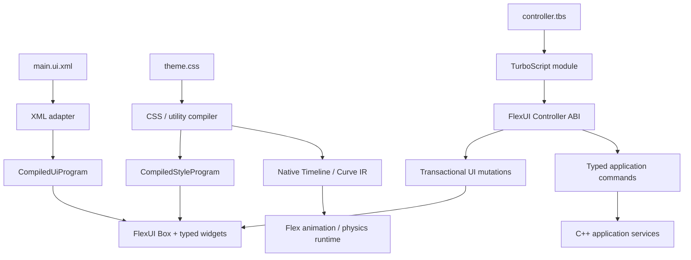
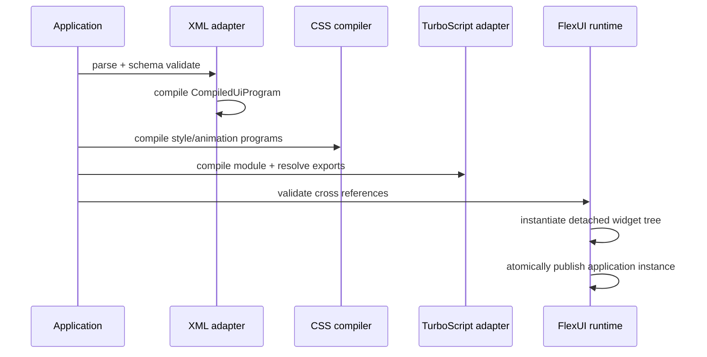

# FlexUI XML、CSS 与 TurboScript 架构决策

状态：架构决策已采用，实施与验收按下列工作项推进
日期：2026-08-31

## 2026-10-28 P4.4 M1 结构子树及其 Binding 所有权原子退休（Draft）

本轮增加 `Box::retire_bound_structural_subtree(id)`，显式处理手工管理的
**结构子树和它独占的 Binding target 记录**。Box 的既有预检完整验证
节点归属、编译程序、脚本事件、Widget、租约、线程及活动指针，并确认
UiBindingRuntime 没有正在执行的 `update` 或安装事务。提交时先解除本子树
Binding 所有权键及依赖表，**不把值恢复到将要析构的 Element**，
再执行无分配的子树回收。未删除兄弟节点和其 Binding 不受影响，
应用级输入仍由原单一 `UiDataContext` 持有；旧 BindingHandle 失效。
拒绝回调、Widget value observer 和全部 `CompiledUiProgram` 实例。

现有 `retire_unbound_structural_subtree` 仍是仅无 Binding 子树的严格入口。
M1 也**不是**动态 XML 组件 `unmount(scope)`，因为不能擅自修改不可变
事件表、Controller、服务完成/租约或组件资源。此边界仍由 #275 后续追踪。

## 2026-10-27 P4.4 M0 有界 Box 子树回收（已合并 PR #286）

此阶段先为 Box 添加 `retire_unbound_structural_subtree(id)`，提供
**真正原地删除**应用自有结构子树的底层生命周期原语。执行前完整审计
Box 所有权、父子指针、ID 索引、Binding 目标、Widget、编译事件属性、
鼠标/键盘活动指针、Element 原生 ClickCallback 与事件分发深度；
任何一个条件不满足都必须拒绝。
成功后撤销索引、清理 CSS/动画/过渡缓存，所有旧 `UiHandle` 失效，
不改变未删除兄弟节点的对象地址和 generation。

已经由 `UiDocumentInstantiator` 挂载了不可变 `CompiledUiProgram` 的 Box
也一律拒绝此底层操作：否则即便目标节点没有绑定，程序的静态定义也会
与运行时树分叉。M0 的准入还要求由 Box 构造线程执行。
**严禁**把这个 M0 API 直接当成已有脚本组件的通用 `unmount(scope)`：
它不修改编译期 `CompiledUiProgram` 的 handler/binding 清单，也不承担
外部 service lease 或 pending callback 的取消。带有 Binding、Widget
或 on: 事件的组件仍拒绝原地销毁；这些能力属于 P4.4 后续门禁。
当前已合并的整代重组 #285 继续作为需要完整组件功能时的权威路径。
没有新增 UI Owner、DOM/BytesVM、fallback。

## 2026-10-27 P4.3 整代组件集合重组（已合并 PR #285）

P4.2 已通过 #284 合入 master。P4.3 引入
`DesktopApplication::recompose_scoped_xml_components(components, input_aliases)`，
**显式**传入新的完整组件列表与绑定别名列表。它重用现有
`DesktopApplication::reload` 的候选装配→校验→服务/完成端口 generation 结算→
单次 `Box`/Controller 原子切换流程。添加、更换或移除 scope 都通过
完整应用 generation 更新；新程序中的事件和 Binding 表在挂载前统一编译，
旧组件随整个前代 `PublishedApplicationState` 回收。

它不是运行中对原有 Box 的子树就地 detach/remove，不承诺保留组件内瞬态
state，不引入逐组件异步取消或独立脚本上下文。传入的映射必须全部显式，
且目标仍是已声明的 application-global `UiDataContext` 种子输入。
失败回滚必须保持旧代可操作与配置不变，成功后标准 `reload` 继续沿用
新的集合。必须以真实作用域 Event/Effect、Typed Binding、generation、
异常失败及 Windows/macOS/Linux 原生 SDK 测试验证。

## 2026-10-27 P4.2 静态组件显式输入别名（已合并 PR #284）

P4.1 已通过 PR #282 合入 master。本轮为复用的 XML 组件增加编译期、
**显式**输入映射。例如模板中 `bind:text="$caption"`，可用
`builder.scoped_binding_alias("sales", "caption", "sales_caption")`
将此处源绑定到 `builder.binding_input_string("sales_caption", "Revenue")`，
而第二实例 `costs` 可以选择另一个声明的输入。布尔/数值 MIR 表达式亦可
对完整变量名做定向重写，字符串字面量与函数名不受改写。

组件不会获得独立的 `UiDataContext`；全部输入由单一应用 Box 持有。
未知作用域、缺失已声明的应用输入、重复或未使用的映射均拒绝。完整 reload
仍从显式种子值创建全新候选；动态 mount/unmount、私有输入生命周期、
资源所有权和安全能力隔离仍属后续工作。

## 2026-10-27 P4.1 组件作用域（已合并 PR #282）

此阶段基于已合并的 Chart/Infographic/DOT XML 事务装配与完整 DOT
源码→GraphLayout→Widget 测试。PR #282 已合并；以下为已验收契约。

- `DesktopApplicationBuilder::scoped_xml_component(scope, host_id, xml)` 仅在应用
  **首次挂载/完整 reload 前**组合组件；宿主必须是根 XML 中已存在的结构节点。
  各个组件的 `id="action"` 编译为 `sales::action` / `costs::action`；
  事件、binding 目标、`for`、局部 `href="#id"` 和 ARIA IDREF 同步限定作用域。
  普通 XML 属性与 `attr:` 命名空间形式都处理同一个 IDREF 规则，二者同时
  声明同一语义属性会拒绝，避免不受作用域约束的值覆盖安全值；外部 URL 不改写。
- 所有 `on:*` 事件归于**同一个** `CompiledUiProgram` 和 `ScriptController`；
  UI Mutation / Application Command 仍按原本预留→提交→发布的顺序进行。
- 对跨实例输入共享采用**显式应用级**声明，例如
  `builder.binding_input_string("caption", "Ready")`，在 UI 事务挂载前创建
  `UiDataContext` 的类型化输入。组件的 `bind:text="$caption"` 指向该应用级输入；
  两个组件若要独立值应声明不同输入名称，而非假定存在隐式组件私有数据源。
  还提供 `binding_input_number` 和 `binding_input_bool`。配置中的同名输入、
  超限字符串、非有限数字、与 Binding 不匹配的输入类型在候选发布前拒绝。
  布尔/数值输入可供编译后的 MIR 表达式使用；成功 reload 会按声明的初始输入
  重新构建候选，运行中修改的输入值**不会被隐式继承**，应用如需保留状态应显式重放。
- `slot` 保持实例局部语义，静态组合仅把重复的 slot 降为 `data-slot`，
  不在全局建立重复 Slot 键。每个节点的真实身份仍归 Box 唯一索引管理。
- **禁止**动态逐组件脚本注册/卸载、组件独立权限、安全隔离、未声明资源跨实例
  共享与动态 input 自动命名。这些需要额外的生命周期与所有权契约，
  不能仅凭作用域 ID 或一个通过的渲染测试放行。

这个方案继续使用原生 XML + StyleEngine/TailwindCSS JIT + TurboScript Host ABI；
没有 BytesVM、浏览器 DOM、WebView 或第二份 UI 树。

## 2026-10-22 实施范围与目标契约

以下区分已合并源码与长期设计；后文的架构决策不代表全部能力已经验收。

| 边界 | 当前事实 | 尚未完成 |
| --- | --- | --- |
| Text/Unicode | #76/#77/#78 已合并：XML 完整字节视图严格准入、Unicode 17 emoji 属性与呈现策略分离、字素级近似宽度/间距；事实与边界来自 `Salts::Unicode` | 真实 shaping/glyph advances、测量接入、编辑几何、完整应用字符串边界；见 [#15](https://github.com/qigao/stun/issues/15) |
| XML | #12/#13/#14 提供注册内容模型预检、匿名节点、自然文本与严格 UTF-8 准入 | 完整 property/event/binding schema、稳定内部身份、精确解码文本 source map 和有序混合内容；见 [#16](https://github.com/qigao/stun/issues/16) |
| CSS/Tailwind | 当前 catalog/JIT 生成 CSS 并进入同一个 StyleEngine cascade | 固定的 Tailwind v4 compatibility profile 与完整声明范围；见 [#17](https://github.com/qigao/stun/issues/17) |
| Application | detached candidate 与 owner-thread publication/reload；真实无窗口 XML/registry/application 测试验证预检及失败回滚 | 真实 TurboScript JIT、完整 desktop/editor、安装分发及跨平台验收；见 [#31](https://github.com/qigao/stun/issues/31) |

### Text / Unicode 目标契约

公开字符串边界的目标编码是严格 UTF-8；非法输入应返回结构化错误，不静默替换。
已验证的合法 bytes 保真，不隐式执行 NFC/NFD normalization。source/storage offset 以 byte
表示；cursor/delete/selection 等用户可见操作应遵守 extended grapheme boundary，此项尚不能
视为所有编辑控件的已完成行为。

Unicode scalar、版本化 property、grapheme/word/line-break/bidi 基础事实由独立
`Salts::Unicode` 提供；FlexUI 不维护第二份 Unicode 数据表。CSS typography、段落布局、
font shaping/measurement、glyph 与 GPU font resource 分别属于其上层边界。
`approximate_text_width()` 仍是近似值；字素计数正确并不构成真实字形测量。

### XML typed schema 目标契约

目标 descriptor 区分 structural/container、leaf/content widget、composite widget、text 和
后续 reusable component，并声明 properties、events、bindings、content model 和可选 factory。
非法组合应在带 source location 的 compiler/registry 边界拒绝；不能只在 paint 时发现错误。

已实现的自然文本与匿名节点写法例如：

```xml
<label>保存</label>
<button id="save" on:click="save">Save</button>
```

事件示例要求外围 `ui` 声明 `xmlns:on="urn:flexui:event"`。匿名结构或控件节点不进入名称索引，
也没有公开 `UiHandle`；稳定内部 reconciliation identity 尚未完成。公开 handle 仍基于显式 ID
与 generation，事件及 binding 目标必须有显式 ID；显式空 ID 仍报错。

自然文本按顺序合并 PCData/CDATA，只裁剪两端 XML 格式空白；文本与元素子节点混排明确报错。
实体解码及裁剪后的文本诊断锚定首个原始贡献文本节点，`SourceSpan.length == 0` 不表示已实现
精确原始范围映射。当前内容模型只覆盖注册 tag、文本许可与子节点数量，不等于完整控件 schema。

格式编译器产出结构程序；canonical application 与带 registry 的实例化先完成整树内容预检，
再调用工厂或修改 Box，应用在加载 CSS 前也完成预检。无 registry 的重载保留为显式通用 Element
兼容入口，不代表已通过 typed schema；统一的 registry-aware 公共编译 API 仍由 #16 跟踪。

### Tailwind compatibility 目标契约

目标 authoring surface 是标准 `class="..."`，普通 semantic class 与 Tailwind candidate 共存，
utility 只生成进入同一个 cascade 的规则。固定 Tailwind v4 profile 后，逐项声明 utility、
variant stacking、responsive、dark、data/aria、container query、theme 与 arbitrary syntax 的
支持范围；识别但不能表达的语义应明确报 Unsupported，不重新解释为本地不同语义。

官方 Tailwind compiler 可作为开发期 differential oracle，不作为安装后的 Node/npm 依赖。
`utility_whitelist.json`、`UtilityCatalog` 与 exact-token lookup 继续作为当前实现及 coverage 数据，
不能据此声称完整 Tailwind v4 兼容。只有 profiling/benchmark 证明必要时才考虑直接 Style IR lowering。

## 背景

FlexUI 需要形成类似 Qt `.ui` + QtScript 的桌面应用开发模型，但不引入浏览器 DOM、JavaScript
运行时或 npm 生态。现有 `.flex` DSL 同时承载 UI、动画、状态机、资源和表达式，导致文档结构、
交互语言与动画运行时的职责重叠，也让 `Flex::Compiler` 成为 FlexUI 的构建依赖。

## 决策

- XML 是 UI 结构与静态属性的唯一源格式。
- CSS 是视觉、状态样式、transition 与 keyframes 的同一个 cascade；Tailwind utility 编译到该 pipeline。
- TurboScript（TBS）是交互、应用状态和命令编排的唯一可执行脚本语言；TBS 不创建或遍历一个
  通用 DOM，也不逐帧驱动动画。
- Flex 的原生 Timeline、Track、Curve、显式三次贝塞尔、Physics/Box2D 和数值 MIR 保留为运行时
  能力；它们不属于要删除的 Flex DSL。
- `.flex` parser、lexer、AST、binary DSL format 和 `Flex::Compiler` 在迁移完成后删除。
- XML、CSS 和 TBS 都先编译为不可变程序，再在 UI owner thread 上实例化或执行。



## 职责与状态归属

| 层 | 主事实源 | 可变性 | 错误边界 |
|---|---|---|---|
| XML adapter | XML source | load/reload 时可替换 | 语法、schema、source location |
| `CompiledUiProgram` | UI definition、事件和 binding 表 | 不可变、可共享 | 语义、资源上限、重复 ID |
| CSS compiler | stylesheet source | load/reload 时可替换 | selector、property、animation 引用 |
| Box/widget tree | 已实例化 UI 状态 | 仅 UI owner thread 修改 | mutation commit |
| TurboScript controller | controller locals | 仅 controller owner thread 修改 | ABI、limits、handler export |
| Timeline/Physics | 动画与物理状态 | runtime owner thread 修改 | 非法参数、缺失 target、资源上限 |

TBS 的一次事件返回一个不可变 effect envelope。宿主先完整校验 `mutations` 与 `commands`，再提交；
校验失败时 Box 与应用服务都不得观察到部分结果。动画的长期状态由原生 runtime 持有，TBS 只发送
类型化的 `play`、`pause`、`seek`、`set_parameter` 等命令。

## 编译与装载顺序



任一阶段失败都立即返回结构化错误。旧实例在 reload 成功提交前继续作为唯一活动实例；不进行静默
降级，也不混用新旧文档的部分产物。

## 当前 XML 实现契约

XML adapter 只负责格式适配，不持有业务状态。元素名称通过 `WidgetRegistry` 映射到具体 widget
factory；typed load 拒绝未知 tag、重复非空 ID、重复属性及已有受约束属性的类型错误。完整的
逐控件属性 schema 尚待 #16。通用属性映射到
`UiNodeDefinition::properties`，事件使用 `on:*`，binding 使用 `bind:*`，命名空间在 adapter 边界
转换为现有 canonical key（如 `on.click`、`bind.text`）。资源使用独立、受限的 `<resources>` 区域，
最终产生 `UiResourceDefinition`。

XML 解析采用仓库 vcpkg manifest 已声明的 pugixml，并通过其 CMake imported target 隔离在 adapter
实现内；公共头不暴露 pugixml 类型。上游接口与解析行为参考
[pugixml manual](https://pugixml.org/docs/manual.html)。

`WidgetRegistry` 是实例化的唯一工厂事实源。内置 widget 在启动时显式注册；插件只能通过版本化
宿主接口注册 factory，不得把第三方类型或 native pointer 写入 XML IR。

当前 `WidgetRegistry::builtins()` 显式注册：

- 结构元素：`div`、`span`、`main`、`section`、`article`、`header`、`footer`、`nav`、
  `aside`、`form`、`fieldset`、`legend`、`p`、`a`、`ul`、`ol`、`li`、`window`、`view`、
  `box`、`content`。
- 基础控件：`button`、`label`、`input`、`checkbox`、`radio`、`switch`、`slider`、
  `progress`、`textarea`、`select`、`image`。
- 组合控件：`tooltip`、`modal`、`tabs`、`badge`、`spinner`、`divider`、`toast`、
  `dropdown`、`accordion`、`calendar`、`table`、`tree`、`colorpicker`、`group-button`、
  `toggle-group`、`avatar`、`card`、`breadcrumb`、`pagination`、`stepper`、
  `gradient-editor`、`markdown`。

基础控件 factory 消费已类型化的常用属性，例如 `text`、`value`、`placeholder`、`disabled`、
`checked`、`min/max/step`。类型不匹配返回 `WidgetFactoryFailed`。Registry 通过实例化入口显式注入；
不带 Registry 的旧入口继续创建通用 `Element`，只用于迁移兼容。

## 表达式策略

短期保留现有数值 MIR 作为 CSS animation、binding 与原生 runtime 的编译后执行后端。这不是保留
Flex DSL：用户不再编写 `.flex` 文档，MIR 也不负责 UI 结构或事件编排。

如果后续要求所有表达式都使用 TBS 语法，应在 TurboScript 仓库提供受限的 pure-expression profile：
禁止 I/O、宿主调用、分配和循环，编译一次后通过类型化输入槽执行。该能力可替换表达式前端，但不应
让完整 TBS VM 进入每帧逐属性热路径。在 TurboScript 提供并通过数值一致性与 benchmark 验证前，
不得假定该 API 已存在。

## 兼容性与迁移

迁移期间采用双前端、单 IR：旧 `.flex` parser 与 XML adapter 都只能输出同一个
`UiDocumentDefinition`/`CompiledUiProgram`，后续实例化、binding、事件和测试完全共享。双前端是有
移除期限的迁移机制，不是长期公开能力。

删除旧 DSL 的门槛：

1. FlexUI、FlexPlayer、examples、FlexChart 与工具中的 `.flex` 消费者均已迁移或明确移除。
2. XML 对 UI tree、属性、事件、binding 和资源具备等价测试。
3. CSS/native runtime 对仍需保留的 animation、curve、physics 行为具备回归测试。
4. 安装树不再导出 `Flex::Compiler`、`Flex::DSL` 或 DSL headers。
5. 全仓库 configure/build/test 和 install-tree consumer 验证通过。

回滚以 frontend feature 为单位：XML 成为默认后，旧 parser 可在一个发布周期内由显式兼容选项启用；
它仍输出相同 IR，不维护第二套 runtime。删除 release 之后的回滚只能恢复独立的兼容分支或版本，
不能在主线重新引入双事实源。

## 当前实现与风险

- `事实`：`DesktopApplicationBuilder::xml_entry()` 已是默认入口，并默认注入
  `WidgetRegistry::builtins()`；TurboScript 通过 `ScriptModuleFactory` 注入，因此 Core 公共边界不暴露
  TurboScript 类型。候选只有在 strict CSS、typed widget、required export 与 mount 全部成功后发布。
- `事实`：`DesktopApplication::reload()` 在 owner thread 构建完整候选并一次交换；失败保持活动
  Box/program/controller，跨线程调用返回 `WrongThread`。
- `事实`：`DesktopApplication::dispatch_event()` 已将 hit-test、widget consumption、native callback、
  target→ancestor bubbling 与 controller 串成同步 owner-thread 链路。被 widget 消费的事件默认不进入
  脚本；成功 click 快照同时包含原始 `target` 与绑定节点 `current_target`。
- `HIGH`（事实）：多个工具、示例和模块仍直接消费 `.flex`；立即删除 parser 会破坏公开构建与示例。
- `MED`（事实）：当前 XML event schema 尚未提供“即使 widget 已消费也发送只读通知”的显式选项；
  focus/capture 的完整组合矩阵也仍待补齐，因此 consumed event 统一 fail-closed 为不进入脚本。
- `MED`（事实）：DesktopHost/native window、plugin service 与 application package loader 尚未进入
  当前 Facade；现有实现验证的是 headless application candidate 事务。
- `MED`（推论）：完整 TBS VM 若逐帧求每个属性，会增加调用、分配与 ABI 成本。依据是当前架构的
  per-frame native Timeline 热路径；需以 benchmark 决定是否增加 pure-expression profile。
- `LOW`（常用做法）：XML/CSS/TBS 的职责分离更接近成熟桌面 UI 工具链，但本决策的主要依据仍是
  仓库现有 IR、runtime 与 controller 边界，而不是形式相似性。
