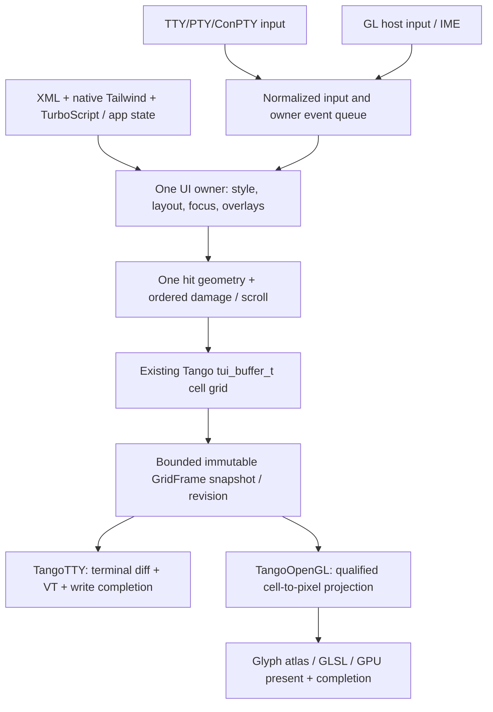

# Tango dual presentation: native TTY and OpenGL

Status: **decision + CPU API/admission boundary**; the native OpenGL Tango
renderer has **not** been implemented or qualified. Tracked by
[Stun #17](https://github.com/qigao/stun/issues/17). This design supersedes
statements that *all Tango renderers* lack shaders. It does not enable a GPU
feature merely by declaring a new API value.

## One Tango UI and cell model, two explicitly selected presenters

```text
XML + native Tailwind + TurboScript / Tango C11 input & model
                              |
                   one cell-layout contract
                    validated tui_buffer_t
                    (UTF-8/grapheme/span,
                    fg/bg/style/scroll)
                              |
                    bounded frame snapshot
                         /         \
         Tango TTY presenter       Tango OpenGL presenter
       stdout/VT/TTY/ConPTY       host-owned GL context/window
            cell diffs            glyph atlas + cell instances
          no GPU/shader           GL shader/pipeline + GPU frame
           terminal IO            pixel framebuffer/display
```

The second path is **a Tango terminal-grid compositor backed by OpenGL**,
not an alias for the generic Flex `RendererBackend::OpenGL` and not a second
UI tree. Both presentations preserve Tango's single canonical Unicode/grapheme
policy, wide-cell continuation, control filtering, text attributes, scroll,
selection and cursor semantics. They may differ in *rendered pixels*.

### Public selection and current availability

| Explicit selection | Semantic domain | Presentation | Status |
| --- | --- | --- | --- |
| `RendererBackend::TUI` / effect `BackendApi::Tango` | TerminalCell | native TTY/VT/ConPTY, or borrowed headless cell buffer | **Existing implementation** |
| `RendererBackend::TangoOpenGL` / effect `BackendApi::TangoOpenGL` | Tango cell-grid source; qualified NativePixel output stage | OpenGL context, glyph atlas and GPU pixel presentation | **Selection and effect metadata only; no registered production renderer** |
| `RendererBackend::OpenGL` / effect `BackendApi::OpenGL` | native Flex pixel UI | existing generic gCanvas OpenGL engine | **Different backend and identity** |

The existing TUI and Tango enum ordinals and their physical-terminal
behavior remain unchanged. `TangoOpenGL` has a distinct registration
slot, but until there is an audited native implementation its factory is
null and explicit creation must fail. Neither path can silently fall back
to the other or to generic gCanvas OpenGL. A renderer switch requires
an explicit new host/presenter selection and fresh admission.

## Native TTY presenter

Owns/borrows the terminal, validates the bounded buffer, produces VT diff
output and handles terminal input and resize on its UI owner. The terminal
is an **external resource**: it must outlive a borrowed renderer. No GL,
shader program, glyph atlas, or GPU fence is part of this path. Terminal
colors (16/256/truecolor) and cell attributes must be independently
admitted. Unsupported blur, shadow, per-pixel alpha and rotation must
not silently become a different appearance.

All existing real TTY/ConPTY/PTy behavior and CI requirements remain
mandatory. A headless `tui_buffer_t` renderer is a test/presenter
option **within the TTY/cell branch**, not an OpenGL implementation.

## Tango OpenGL presenter (implementation target, not current support)

The Tango owner still produces a cell grid. An **explicit, typed**
`TangoGridSnapshot` boundary must freeze cells, spans, grapheme bytes,
generation and row/column dimensions. The OpenGL presenter consumes it
without parsing terminal escape sequences or running another layout.
It uses the existing gCanvas/OpenGL infrastructure for context-owned
resources where its proven APIs fit, plus a dedicated terminal cell
rasterization pipeline:

- cell background quads + per-cell foreground/style instance data;
- glyph atlas pages for text/graphemes and explicit color-emoji policy;
- wide-cell continuation rendering, glyph metrics and atlas invalidation;
- cursor, decorations, selection and clipping with shared cell hit geometry;
- bounded dirty-rectangle uploads and framebuffer damage;
- explicit framebuffer/alpha/color-space/DPI/resize mapping.

The cell-to-pixel projection itself must declare its font metrics, scale,
integer grid dimensions, viewport and source revision. **This M2
effect-admission slice does not implement that projection.** A qualified
TangoOpenGL NativePixel effect must consume the projected texture/content;
a raw `EffectInput::Cells` is rejected rather than relabeled as an RGBA
surface.
`BackendApi::TangoOpenGL` admits only an explicitly selected **NativePixel
effect** applied after the projection, with a qualified desktop GLSL
artifact, GPU stage, installed-program observation, device limits and
native resource owner. It cannot admit a `TerminalCell` output surface,
silently convert arbitrary cell units to pixels, or borrow another
backend's artifact identity. Graphics (vertex+fragment) must be
implemented and qualified first; compute is never implied by OpenGL
availability and requires an independent execution/limits gate.

The new enum/profile **is not a claim that these assets, shaders, glyph
uploads, context recreation or GL entry points already exist**. No
Tango-OpenGL capability snapshot/manifest/factory is registered here.

## Ownership, failure and input

TTY owns terminal output completion, not a GPU fence. Tango OpenGL must
use the GL context/share-group owner and device generation; GL objects are
allocated and retired only with a current compatible context. A frame
must retain glyph pages, buffers and pipelines until its actual GPU
completion. Use the existing `NativeEffectResourceOwner` reservation
and verified scope, but a prepared effect is not permission to release
in-flight GL resources. Device/context loss invalidates only the
corresponding GPU plans; never reroute to TTY or render via a borrowed
stale context.

Physical key/PTY input belongs to TTY. GL-window keyboard, IME, pointer
and wheel input must be mapped through Tango's existing event model and
the canonical cell metrics on the UI owner. A pointer at a cell boundary
cannot hit a different Element than the one painted at that boundary.
Neither renderer may reparse RichDoc/Markdown or maintain a duplicate
business model.

Bound separately: cell count, grapheme payload, snapshot history, atlas
pages/bytes, shader variants, instance buffers, dirty uploads, frames
in-flight and retiring native objects. Check combined live + candidate +
in-flight + retiring peak cost before publishing the new GL plan.

## Acceptance gates (not completed by the enum change)

1. **Profile isolation:** explicit TTY remains shader-free and
   `TerminalCell`; TangoOpenGL requires `NativePixel` for GPU
   presentation/effects; the generic OpenGL profile cannot masquerade
   as TangoOpenGL; absent TangoOpenGL factory fails cleanly.
2. **Shared cell semantics:** C11 Tango unit tests plus positive and
   negative Unicode/grapheme, CJK-wide, combining, emoji, cursor,
   selection, clipping, resize and scrolling fixtures for *both*
   presenters. TTY real PTY/ConPTY remains mandatory.
3. **Real OpenGL:** context supplied by the actual desktop host, exact
   GL/profile and driver recorded, shaders compiled/linked with
   verified resource identity, screenshot/pixel and pointer-hit
   conformance. Software GL is labeled separately from physical GPU.
4. **Lifecycle:** failed GL compile/atlas allocation, stale generation,
   context loss, repeated resize, in-flight frame retirement, old/new
   plan peak budget and rollback all tested without fallback.
5. **Integration:** single XML/Tailwind/Theme/Binding/controller
   semantics, no CSS parser, no GPU work on the TTY path and no
   second Tango renderer VM.

Until all matching target gates pass, the GL presenter is only a
reserved public selection and a **synthetic CPU admission profile**.
The existing TTY implementation and its tests must not be deleted,
weakened or repurposed to pretend OpenGL support.


## Neovim-informed terminal UI protocol and modern interaction design (2026-10-30)

**Status: design/acceptance only, not implemented by #341.** This is a
source-informed contract for the existing Tango engine, *not* a request to
import Neovim/libtermkey, add an editor daemon, install ncurses, clone
Neovim's widgets, or create another TUI runtime. Related: [TTY owner
#165](https://github.com/qigao/stun/issues/165), [typed input and
streaming #266](https://github.com/qigao/stun/issues/266), [shared C11 UI
#167](https://github.com/qigao/stun/issues/167), [portable native
Tailwind #267](https://github.com/qigao/stun/issues/267),
[TangoOpenGL implementation #342](https://github.com/qigao/stun/issues/342),
[unmount/lifetime PR #302](https://github.com/qigao/stun/pull/302).

### 1. Source findings and the boundary to adopt

Neovim's current [UI client](https://github.com/neovim/neovim/blob/master/src/nvim/ui_client.c)
runs the TUI client against an editor server through Msgpack-RPC; its
[UI API](https://github.com/neovim/neovim/blob/master/src/nvim/api/ui.c)
emits redraw events. The [TUI renderer](https://github.com/neovim/neovim/blob/master/src/nvim/tui/tui.c)
maintains a terminal grid, translates cell updates to terminfo/VT
sequences, and flushes buffered output. Its [termkey input
reader](https://github.com/neovim/neovim/blob/master/src/nvim/tui/input.c)
normalizes keyboard, mouse and paste events. Neovim's *built-in* TUI
attaches with `ext_linegrid`, not `ext_multigrid`; editor-side
compositing prepares its screen for that client. External UIs may use
different UI extensions. The separate embedded libvterm is for
Neovim's `:terminal` child-process terminal, not its main UI rasterizer.

**Adopt the separation of semantic state, redraw events and presentation;
do not require Neovim's process split or RPC.** In Stun, the FlexUI/UiCore
owner retains XML state, native Tailwind and TurboScript/binding meaning,
layout, overlay ordering, focus and hit geometry. Existing
`tango/` owns its C11 cell grid, Unicode terminal-column policy,
PTY/ConPTY/TTY input/output, diff and terminal restoration. The
`flex/backends/tui` adapter is *only* the Flex renderer-to-cell bridge,
not a second layout engine, Unicode parser, input dispatcher or terminal.

### 2. Current implementation inventory (do not reimplement)

| Verified repository owner | Existing behavior | Missing contract or qualification |
| --- | --- | --- |
| `tango/include/tui.h`, `tui_buffer.c` | `tui_cell_t` stores owned bounded UTF-8 grapheme bytes, span and continuation; `tui_buffer_t` records cell dimensions and dirty bounds | Frozen/versioned frame read view with owner/generation; safe overlapping layered writes and explicit damage/scroll records |
| `tango/src/tui_terminal.c` | Terminal output buffering, front/back diff, alternate screen and restoration, bounded write errors | Capability snapshot, optional synchronized-update admission, scroll optimization, presented-vs-candidate revision on partial output/error |
| `tango/src/tui_input.c` | Stateful input parser, SGR mouse, paste handling and Win32 INPUT_RECORD decoding | Declared optional keyboard/focus extensions, ESC timeout/unknown-reply policy, split-protocol/trust tests and event parity |
| `flexUI/`, `flex/backends/tui` | Retained Elements, layout/events, Flex drawing adapter using terminal cells | One overlay composition/hit-geometry contract; no silent GPU-only effects, no duplicate focus or widget tree |
| #341 reserved TangoOpenGL slot | Explicit identity and CPU effect-admission profile only | **No** actual GL presenter, atlas, pixel projection, shader resources or screenshot qualification |

The earlier assumption that Tango requires a brand-new `TangoCell` or
front/back grid is **superseded by this source audit**. Reuse
`tui_cell_t`, `tui_buffer_t` and existing diff logic. Add only the
smallest versioned read/snapshot and redraw boundary justified by tests.

### 3. Normative owner / redraw / presentation transaction



The diagram is **logical**, not a declaration of a new always-on event
transport, per-frame allocation or public ABI. At most one UI owner
publishes a particular grid/frame revision. The frame boundary must
carry checked `grid_generation`, `ui_revision`, `viewport_revision`,
rows/columns, a borrowed-or-owned lifetime token, bounded cell/grapheme
data, style/cursor state and dirty/scroll regions. A snapshot may borrow
the existing buffer *only while the UI owner pins it*; asynchronous GL
uploads need an immutable retained copy or an explicit completion-scoped
lease. Resizing or retiring a buffer invalidates obsolete borrows.

Proposed *internal* C11 semantic operations (names are sketches, **not
current exported API**): `GridResize`, `GridCells`,
`GridDamage`, `GridScroll`, `Cursor`, `FrameFlush`. An operation
sequence has one version, bounded size, monotonic revision and a final
commit marker. Coalesce repetitive invalidations and preserve the final
visible state; never coalesce away semantically ordered scroll,
focus or resize changes. The existing C11 grid and diff remain the
canonical execution path; avoid forcing cells through a second
Msgpack-RPC-like screen model.

A paint or style/layout callback that requests another revision during
record/replay must remain pending (see #337/#338); no stale callback
may mark a newer frame as presented. UI input and hit-testing must use
the same committed layout/overlay geometry as the visible frame, with
an explicit policy for events arriving during a pending resize/frame.

### 4. Layered components like modern Neovim plugins

A file tree, searchable command palette with preview, tooltip,
statusline and tab/list layout are **FlexUI components** (XML +
class-based native Tailwind + bindings), not direct ANSI writers.
Follow the reusable Popup/Layout/Picker *composition pattern* used by
Neovim's Lua ecosystem; do not embed Lua, an editor buffer model or a
second event framework simply to copy the visual result.

An overlay requires a stable component ID/generation, parent-relative
anchor, bounded rectangle, z-order, clip, keyboard focus, pointer
capture and hit-test mapping, and an owner-checked lifetime. The cell
compositor resolves foreground/background/style and wide-cell pairs in
z-order **before** the TTY diff; no two widgets independently write
stdout. Cursor placement follows the topmost active focus owner and
must be restored when a popup closes. A popover cannot leave half of a
CJK/emoji grapheme or a stale selection behind. Overlay retirement
must honor Widget/Binding observer and plugin callback/worker join
proofs (PR #302); hiding pixels is not a physical unmount.

The **same logical component and interaction semantics** may run in a
native pixel backend, but a TangoOpenGL presenter still draws **Tango
cells**. Full arbitrary FlexUI pixel effects and shaping are not
magically supported just because its output uses OpenGL. Desktop
D2D/gCanvas keeps its distinct pixel renderer and admitted effects.
Never silently approximate an unsupported native Tailwind effect in
TTY or switch to OpenGL.

### 5. Terminal capability and normalized input contract

Start from the already working POSIX/Win32 paths. Add a bounded,
owner-affine `TerminalCapabilitySnapshot` (conceptual) recording
platform/terminal family, geometry, reliable color depth, mouse mode,
paste mode, keyboard protocol, focus reporting, scroll/margin support
and synchronized-output support. Unknown capabilities are **not
supported**; enabled modes must be balanced and restored on teardown,
error, suspend/resume and restart. This snapshot is a terminal IO
capability, not a GPU/Shader capability manifest.

- Preserve raw-mode/alternate-screen/mouse/bracketed-paste/Win32
  restoration evidence. Capability detection must not hang on a reply
  that never comes; bound bytes, time and reply state.
- Preserve the current stateful CSI/SGR/UTF-8 parser and trusted
  bracketed-paste boundary. Add explicitly qualified focus reports,
  modified keys (CSI-u/Kitty where genuinely supported), split escape
  sequences, malformed/unsolicited OSC/DCS/CSI replies, mouse drag,
  release, wheel, resize and ESC-vs-Alt disambiguation.
- Normalize key/text/IME, pointer coordinates, drag, scroll, paste,
  focus and resize to **one** UI owner event path (see #266).
  GL pixel pointer coordinates are mapped through the admitted cell
  metrics and clip, not a guessed `8x16` constant.
- Only the TTY presenter emits terminfo/ANSI/VT. Optional terminal
  scroll-region commands may accelerate a scroll; when unavailable,
  redraw the same cells through the *same* TangoTTY presenter (not a
  backend fallback).
- Optional DEC synchronized output `CSI ? 2026 h/l` is permitted only
  after positive capability qualification. End the transaction even
  on error/stop; never advertise it from a terminal name guess.
  Batch terminal writes and minimize cursor/style transitions.

TTY write completion is not GPU completion and cannot undo bytes
already written. A failed/partial VT write must not advance the
last-successfully-presented revision; require a bounded explicit
full-resync or terminal reset before a new incremental diff, and
surface the error rather than claiming frame success. Backpressure
bounds queued invalidations, output bytes, pending snapshots and
stale revisions; never drop user input or accepted streaming content
merely to improve animation smoothness.

### 6. Qualification plan / test evidence (all new gates OPEN)

| Gate | Evidence required |
| --- | --- |
| M0 source and API boundary | Same `tui_cell_t` and single owner; recorded current API/feature inventory; no parallel terminal, parser, layout, Unicode or CSS implementation |
| M1 overlay & input | One XML/Tailwind file-tree + picker/preview + statusline fixture; real keyboard focus, Escape close, mouse click/drag/scroll, popup z-order/clip, CJK/emoji wide-cell overwrite; post-unmount no borrowed callback |
| M2 redraw and terminal output | Deterministic `GridCells/Scroll/Flush` contract; dirty-area vs full-grid replay equivalence; incremental terminal output measured in bytes/updates; optional sync-mode detection and balanced restoration |
| M3 external terminal oracle | Real Linux/macOS PTY and Windows Console/ConPTY sessions: raw stream capture **and** independently reconstructed visible cells, split CSI/UTF-8/SGR/paste, unknown replies, alt-screen/termios/mouse restoration; test RED on a deliberately wrong visible frame |
| M4 overload/lifecycle | UI owner reentrancy, cancel/resize/close overlap, output-allocation/write errors, partial output resync, blocked terminal, queue saturation, capacity and generation checks, sanitizer/native test evidence |
| M5 TangoOpenGL independent | Real host GL context, atlas and resource owners, exact cell→pixel/IME/pointer mapping, screenshot/pixel+input oracle, context loss, in-flight frame retirement and effect/admission contract per #342 |

Keep M0–M5 **open** until there is exact-HEAD source, real executable
tests and result artifacts. A Neovim reference, Markdown design,
CPU-only test, synthetic cell buffer, hidden-window smoke or renderer
enum is **not** proof of modern UI/TangoOpenGL product readiness.
Use existing workflow caches, FIFO cancellation and separate native
TTY vs real graphical-window evidence. No new HTTP attestation service,
CSS pass, second TUI engine, fallback renderer or unconditional GPU
dependency is authorized by this design.
